# Manual do usuário da Ágora

Este manual mostra como usar a Ágora no dia a dia. Cada seção trata de uma tarefa e diz quais perfis podem fazê-la. Os nomes de botões e campos aparecem em **negrito**, como na tela.

As telas deste manual vêm do ambiente de demonstração, com dados fictícios. No ambiente do seu órgão, os dados serão os reais e o menu mostrará apenas o que o seu perfil permite.

## 1. Entrar, trocar a senha e sair

### Entrar

1. Abra o endereço da Ágora informado pelo seu órgão.
2. Preencha **E-mail institucional** e **Senha**. O botão **Mostrar senha** exibe o que você digitou.
3. Clique em **Entrar**.

Se o órgão tiver habilitado o Login Único gov.br, a tela de entrada mostra também a opção de entrar com a conta gov.br.

> **Atenção:** depois de 5 tentativas com senha errada, a entrada fica bloqueada por 15 minutos. Se você esqueceu a senha, peça ao administrador da Ágora no seu órgão uma senha temporária.

### Primeiro acesso e senha temporária

Quando o administrador gera uma senha temporária para você, ela vale por 72 horas. No primeiro acesso, a Ágora pede a troca de senha antes de qualquer outra tela.

### Trocar a senha

1. No canto superior direito, clique no seu nome. O menu mostra seu nome completo, seus perfis e o escopo de UASGs que você pode ver.
2. Clique em **Trocar senha**.
3. Preencha **Senha atual**, **Nova senha** e **Confirmar nova senha**. A nova senha precisa ter pelo menos 12 caracteres e ser diferente da atual. Uma frase longa e fácil de lembrar é a melhor escolha.
4. Clique em **Trocar senha**. A lista de requisitos abaixo dos campos mostra o que ainda falta.

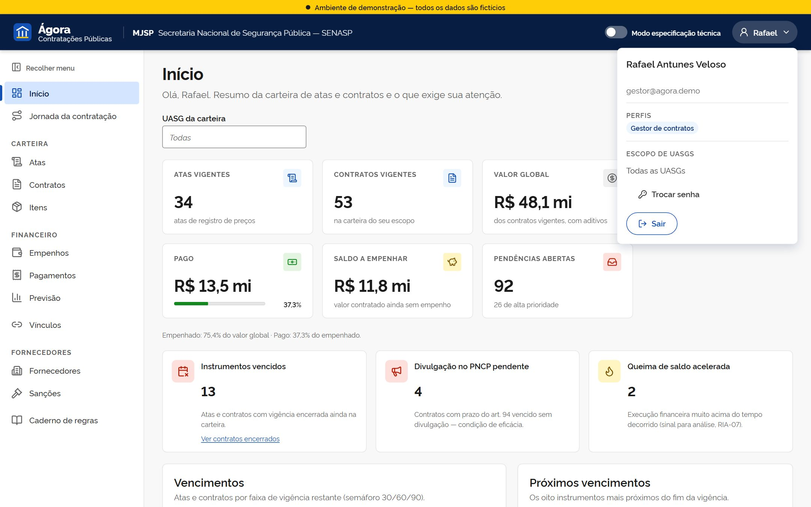

### Sair

Clique no seu nome e depois em **Sair**. Por segurança, a sessão também expira sozinha. Quando isso acontece, a Ágora pede que você entre de novo e depois volta para a tela em que você estava.

## 2. Conhecendo a tela

- **Faixa amarela no topo:** aparece só nos ambientes de demonstração e de homologação, para lembrar que os dados não são reais.
- **Cabeçalho:** a marca da Ágora leva ao início. Ao lado ficam o nome do órgão, o botão **Modo especificação técnica** (seção 14) e o menu com o seu nome.
- **Menu lateral:** organizado em grupos (Carteira, Financeiro, Fornecedores e outros). **Recolher menu** deixa só os ícones, para ganhar espaço. Itens que o seu perfil não pode usar não aparecem.
- **Área principal:** no alto fica o caminho da página (por exemplo, "Início › Contratos"), que serve para voltar. Abaixo dele vêm o título e os botões de ação da página.

### Tabelas, buscas e filtros

As listas da Ágora funcionam todas do mesmo jeito:

- **Buscar** e os filtros ficam acima da tabela. O número de resultados é atualizado a cada filtro.
- Clique no título de uma coluna para ordenar por ela.
- **Colunas** escolhe quais colunas aparecem. **Densidade** deixa a tabela mais compacta ou mais espaçada. **Itens por página** e os botões de página ficam no rodapé da tabela.
- Os filtros ficam guardados no endereço da página. Para mostrar a mesma lista a um colega, basta enviar o link.

### Avisos e erros

- Depois de uma ação, um aviso confirma o que foi feito. Algumas ações oferecem **Desfazer** no próprio aviso.
- Quando algo dá errado, a mensagem explica o problema e mostra um **Código para o suporte**. Envie esse código ao suporte do seu órgão: ele identifica exatamente o que aconteceu.

### No celular

No celular, o menu lateral vira o botão **Menu**, e cada linha das tabelas vira um cartão com as informações principais.

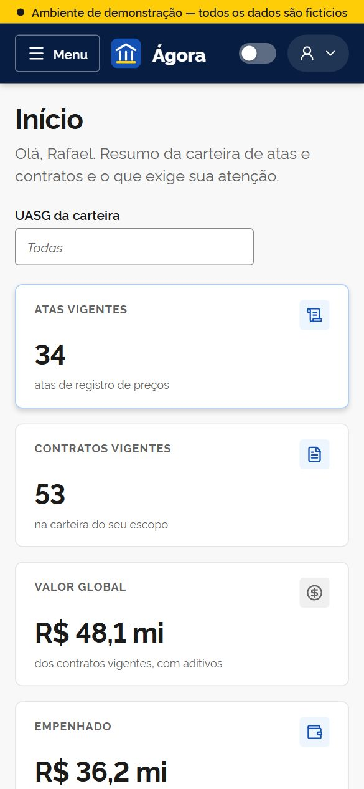 

### Acessibilidade

A Ágora segue o Padrão Digital de Governo e pode ser usada só pelo teclado: **Tab** avança, **Shift+Tab** volta e **Esc** fecha janelas. O primeiro item da página, **Ir para o conteúdo principal**, pula direto para o conteúdo. A tela funciona com zoom de até 200% e com leitores de tela.

## 3. O que cada perfil pode fazer

O que você vê e faz depende de dois controles, ambos verificados pelo servidor a cada ação:

- os seus **perfis**;
- o seu **escopo de UASGs**, isto é, as unidades cujos dados você pode ver.

| Perfil | Principais tarefas |
|---|---|
| Gestor de contratos | Acompanha atas e contratos, resolve pendências, conclui tarefas do plano de gestão, vincula instrumentos e instaura processos sancionatórios. Consulta a jornada da contratação. |
| Fiscal de contrato | Cumpre as tarefas do plano de gestão, resolve pendências e **atesta notas fiscais**. |
| Financeiro | Acompanha empenhos, pagamentos e a previsão, vincula empenhos e executa as sincronizações com os sistemas do governo. |
| Planejamento | Conduz a fase preparatória da jornada: DFD, ETP, matriz de riscos e pesquisa de preços. |
| Agente de contratação | Conduz a seleção do fornecedor e **publica** editais e avisos no PNCP e no DOU. |
| Assessoria jurídica | Faz o controle prévio de legalidade (art. 53) e registra o parecer. |
| Auditor | Consulta tudo, verifica a trilha de auditoria e acompanha os acessos a dados pessoais. Pode revelar dados pessoais, com finalidade registrada. |
| Consulta | Somente leitura dos instrumentos e da execução financeira das UASGs autorizadas. |
| Administrador | Cuida de usuários, ajustes e integrações. Tem todas as permissões. |

A tabela completa de permissões está em **Administração › Perfis** (para o administrador). Se você precisa de uma função que não aparece no seu menu, peça ao administrador para ajustar os seus perfis.

## 4. Início e fila de pendências

A tela **Início** reúne o que pede atenção na carteira:

- indicadores e vencimentos em 30, 60 e 90 dias;
- contratos com prazo de divulgação no PNCP vencido (art. 94);
- contratos com queima de saldo acelerada;
- os próximos vencimentos.

Cada conjunto de dados informa a fonte e o horário da última atualização. Enquanto carrega, a tela mostra blocos cinzas no formato do conteúdo; números zerados durante o carregamento não acontecem.

### Resolver uma pendência

Perfis: gestor de contratos, fiscal de contrato e administrador.

1. Em **Fila de pendências**, use os filtros **Tipo**, **Prioridade**, **Situação** e **UASG**, ou marque **Somente as minhas**.
2. Na linha da pendência, clique em **Resolver**.
3. Em **Observação da resolução**, explique o que foi feito (até 500 caracteres), por exemplo: "Termo aditivo de prorrogação assinado em 05/11". O campo é obrigatório.
4. Clique em **Resolver pendência**. Se você se enganou, clique em **Desfazer** no aviso que aparece.

A resolução fica no histórico do contrato ou da ata e na trilha de auditoria.

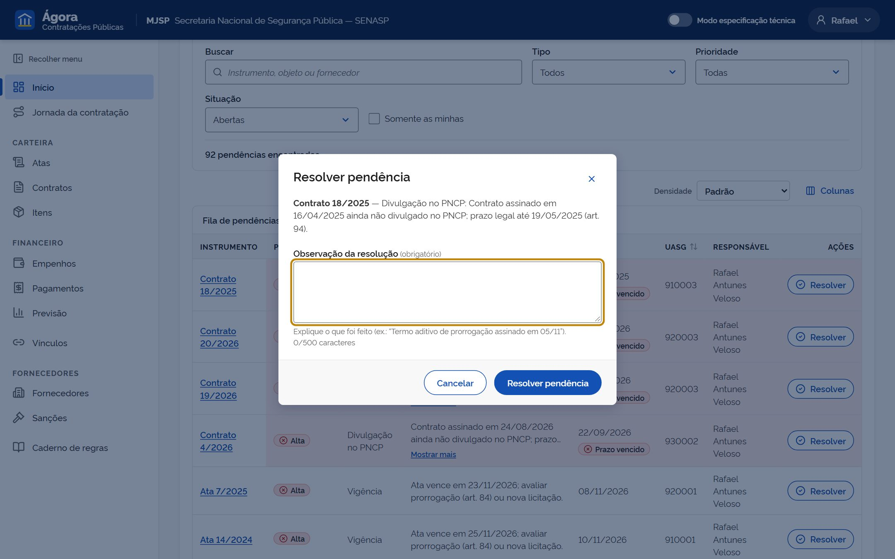

## 5. Contratos

Em **Contratos**, filtre por **Situação** e **UASG**, ou marque **Sob minha gestão** e **Sem ata de origem**. Clique no número do contrato para abri-lo.

A página do contrato mostra:

- **Resumo do contrato** e **Linha do tempo**, da assinatura ao fim da vigência;
- **Divulgação no PNCP:** situação e prazo do art. 94;
- **Queima de saldo:** ritmo de execução e projeção de quando o saldo acaba;
- **Garantia contratual.**

Os botões ao lado do número copiam o número do processo e o identificador do PNCP. **Abrir no PNCP** abre o registro oficial em outra aba.

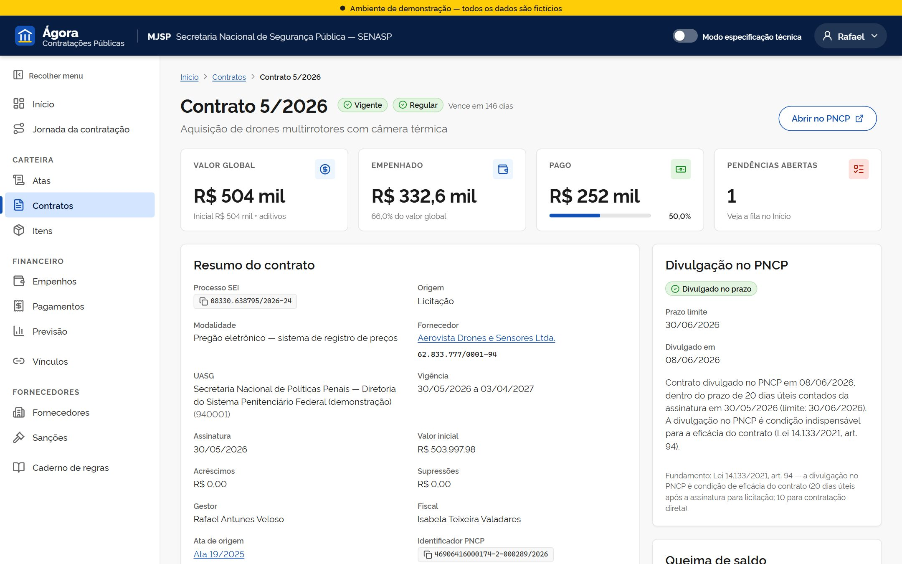

As abas trazem o restante:

- **Plano de gestão:** tarefas de fiscalização e gestão, geradas pelos modelos de gestão. Gestor e fiscal usam **Concluir tarefa** e **Reabrir tarefa**.
- **Itens, Empenhos e Pagamentos:** a execução física e financeira do contrato.
- **Aditivos:** termos aditivos registrados e o simulador do art. 125.
- **Histórico:** tudo o que aconteceu com o contrato, inclusive as pendências resolvidas.

### Simular um aditivo (art. 125)

1. Abra a aba **Aditivos**.
2. Em **Tipo de alteração**, escolha **Acréscimo** ou **Supressão**.
3. Informe o **Valor da alteração**. Marque **Reforma de edifício ou de equipamento** se for o caso: o limite de acréscimos passa de 25% para 50%.
4. Clique em **Simular**.

O resultado mostra o percentual acumulado, o limite legal e a margem restante. Mostra também se o fornecedor está regular para assinar (consulta ao CEIS/CNEP e à regularidade fiscal, RN-09). A simulação não grava nada: o termo aditivo continua dependendo de justificativa, disponibilidade orçamentária e manifestação jurídica.

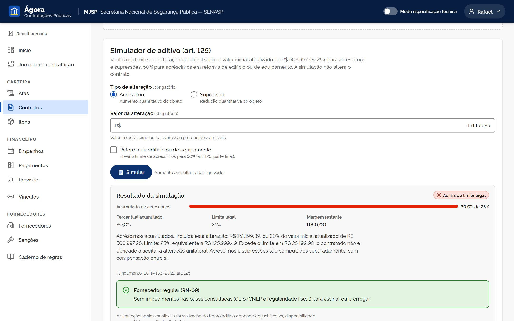

## 6. Atas de registro de preços e itens

Em **Atas**, a aba **Registradas** lista as atas vigentes e encerradas, e a aba **A montar** lista as que ainda estão em preparação. Os filtros são **Situação**, **Criticidade**, **UASG** e **Sob minha gestão**. A coluna **Consumo** mostra quanto da ata já foi contratado.

A página da ata mostra os dados, a linha do tempo e as abas **Plano de gestão**, **Itens**, **Contratos vinculados**, **Reajuste** e **Histórico**.

Em **Itens** fica a carteira de itens de todas as atas e contratos, com os filtros **UASG**, **Alocação em contrato** e **Empenho**. O botão **Exportar CSV dos itens filtrados** baixa a lista para abrir numa planilha.

## 7. Financeiro

### Empenhos

Em **Empenhos**, filtre por **Saldo**, **Restos a pagar**, **Ano de emissão** e **UASG**. A tabela mostra o valor empenhado, o valor pago e o saldo de cada nota de empenho.

### Pagamentos e atesto de notas fiscais

**Pagamentos** segue a ordem cronológica de pagamentos por fonte de recurso (art. 141). A coluna **Ordem** mostra a posição de cada parcela.

Para atestar uma nota fiscal (perfis fiscal de contrato e administrador):

1. Na linha da nota, clique em **Atestar**.
2. Confira nota fiscal, contrato, fornecedor, competência, vencimento e valor.
3. Clique em **Atestar pagamento**.

> **Atenção:** ao atestar, você confirma que o objeto foi entregue ou executado conforme o contrato (art. 140). O atesto fica na trilha de auditoria e **não pode ser desfeito por esta tela**.

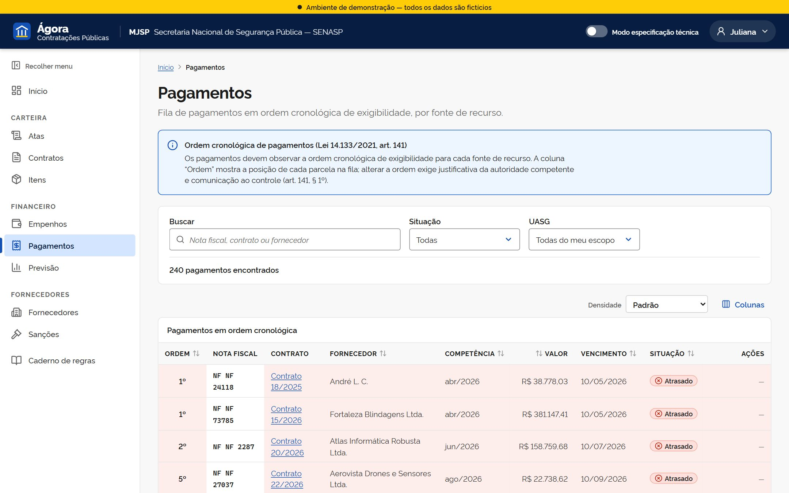

### Previsão de pagamentos

Escolha o **Exercício**. O gráfico compara o previsto e o realizado de cada mês, e a tabela abaixo dele detalha o previsto e o realizado de cada contrato no ano.

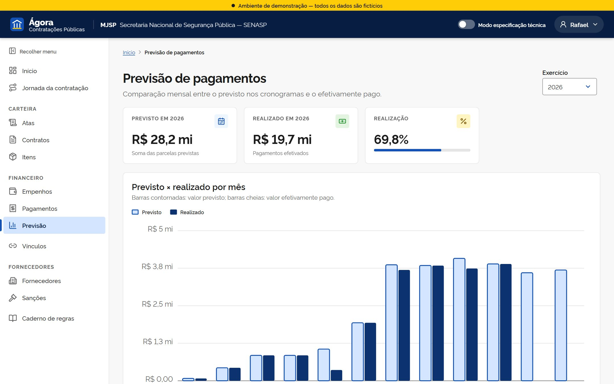

## 8. Vínculos

Perfis que podem vincular: gestor de contratos, financeiro e administrador.

**Vínculos** junta o que ficou solto na carteira, em três abas:

- **Contratos sem ata**
- **Empenhos sem contrato**
- **Empenhos sem item**

O número ao lado de cada aba mostra quantos casos há. A Ágora sugere o vínculo mais provável e mostra o grau de **Confiança** da sugestão.

1. Confira a sugestão na linha.
2. Clique em **Vincular** e confirme. O consumo da ata e o saldo contratável são recalculados.
3. Se precisar, use **Desfazer** no aviso que aparece em seguida.

## 9. Jornada da contratação

A jornada conduz cada contratação pelas 7 etapas da Lei 14.133/2021:

1. Demanda e PCA
2. Instrução no SEI e equipe
3. ETP, riscos e preços
4. TR, edital e minuta
5. Controle jurídico e publicação
6. Seleção do fornecedor
7. Contrato e gestão

Quem trabalha em cada etapa:

- **Planejamento e agente de contratação:** editam o processo.
- **Assessoria jurídica:** registra o parecer.
- **Agente de contratação:** publica.
- **Gestor e auditor:** acompanham, sem editar.

### Criar um processo

1. Em **Jornada da contratação**, clique em **Novo processo**.
2. Informe o **Objeto** (título do processo) e o **Órgão requisitante**.
3. Clique em **Criar processo**. O processo começa na etapa 1, com número SEI gerado pela Ágora.

### Como ler a página do processo

- **Faixa de etapas:** mostra onde o processo está. Etapas concluídas têm um sinal de confirmação, e etapas com problema têm um alerta.
- **Painel da etapa:** os formulários e documentos daquela fase.
- **Árvore do processo SEI:** os documentos numerados e as assinaturas.
- **Bloqueios:** regras da lei que **impedem** o avanço até serem resolvidas.
- **Sinais:** pontos de **atenção** que não impedem o avanço, como "demanda fora do PCA". Um sinal pede análise humana e nunca é uma acusação.

### Avançar de etapa

1. Clique em **Avançar para a etapa N** e confirme em **Avançar etapa**.
2. O servidor confere todas as regras da etapa. Se alguma não estiver atendida, o processo **permanece na etapa** e o aviso lista cada regra, com a explicação e o fundamento legal.
3. Resolva os bloqueios no painel da etapa e tente de novo.

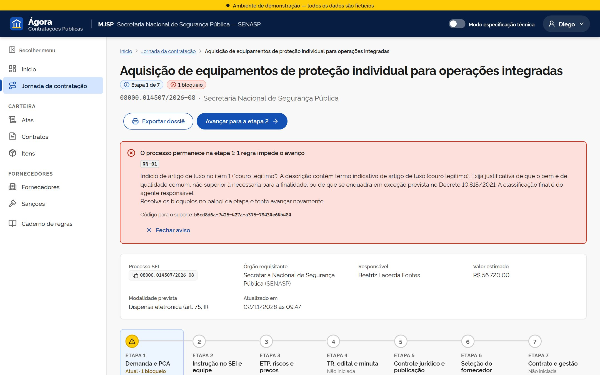

### O que fazer em cada etapa

**Etapa 1 — Demanda e PCA.** Preencha o DFD:

- **Descrição da necessidade**, **Justificativa da contratação** e **Natureza do objeto**;
- os **Itens da demanda**, usando **Adicionar item**;
- a marcação **Demanda prevista no Plano de Contratações Anual (PCA)**.

Se algum item não estiver no catálogo padronizado (CATMAT/CATSER), a justificativa é obrigatória (art. 19, § 2º). Termos que indicam artigo de luxo pedem justificativa de que o bem é de qualidade comum (art. 20). A Ágora também avisa quando a soma das dispensas se aproxima do limite (art. 75, § 1º). Clique em **Salvar DFD**.

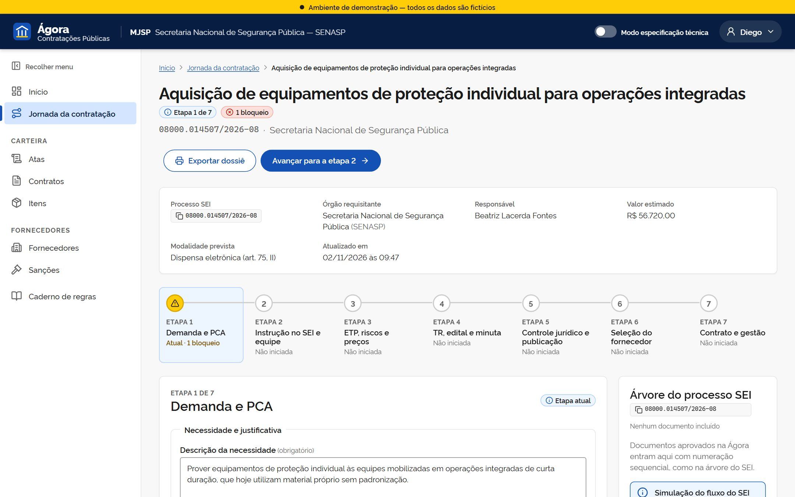

**Etapa 2 — Instrução no SEI e equipe.**

1. Em **Designação da equipe**, use **Adicionar designação** para indicar requisitante, equipe de planejamento, agente de contratação e autoridade competente.
2. Clique em **Salvar designações**. Se a mesma pessoa ocupar funções que a lei manda separar, a Ágora aponta o conflito (art. 7º, § 1º).
3. Na árvore do SEI, assine os documentos com **Assinar documento**.

**Etapa 3 — ETP, riscos e preços.**

- **ETP:** preencha os 13 incisos do art. 18. Os incisos I, IV, VI, VIII e XIII são obrigatórios; para os demais, marque **Não se aplica** e justifique. Clique em **Salvar ETP**.
- **Matriz de riscos:** registre os riscos com **Incluir risco**. O mapa de calor mostra probabilidade × impacto.
- **Cesta de preços:** registre as cotações uma a uma (**Incluir cotação**) ou de uma planilha (veja abaixo).
  - A Ágora sugere expurgos de valores fora da curva (**Expurgos sugeridos**). **Marcar todas as sugestões** seleciona todas de uma vez; uma justificativa vale para todas, e a decisão é sempre sua.
  - Se for o caso, marque o orçamento como sigiloso e informe o motivo (art. 24).

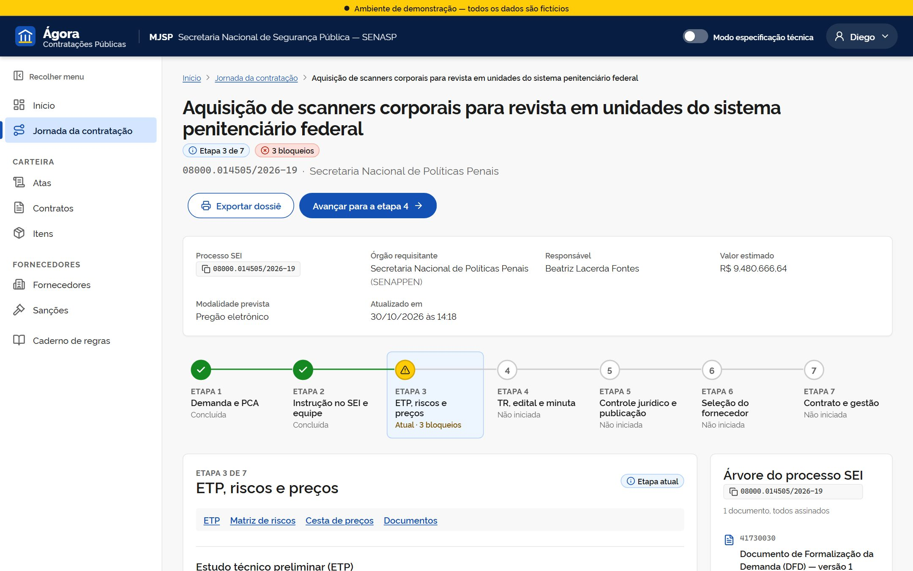

**Importar a cesta de uma planilha.**

1. Na cesta de preços, clique em **Importar planilha**. Se precisar, use **Baixar modelo de planilha (CSV)**.
2. Escolha o arquivo em **Arquivo da planilha** ou cole as linhas copiadas da planilha em **Conteúdo da planilha**.
   - Colunas: fonte, identificação, valor unitário, data da cotação e justificativa (obrigatória na pesquisa direta com fornecedor).
   - A fonte aceita o código, o nome ou o inciso do art. 23, § 1º (I a V).
3. Escolha se as cotações vão ser **acrescentadas** às atuais ou **substituí-las**.
4. Clique em **Conferir planilha**. O servidor confere cada linha e mostra a prévia, com os erros de cada linha. Nada é gravado nesse passo.
5. Com todas as linhas válidas, clique em **Importar**. A análise estatística é recalculada e os expurgos sugeridos aparecem para o seu aceite.

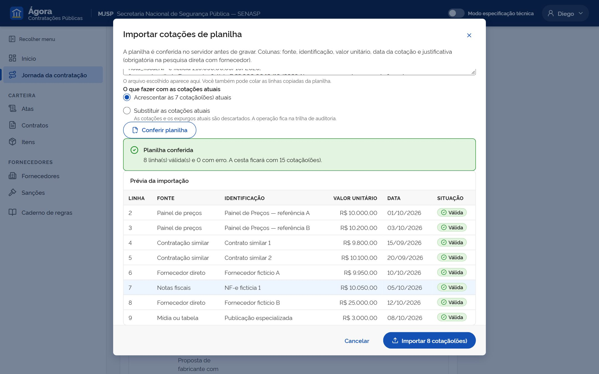

**Etapa 4 — TR, edital e minuta.**

1. Em **Parâmetros do edital**, escolha o **Critério de julgamento** e o **Regime de execução**.
2. Revise as exigências de habilitação econômico-financeira. A Ágora bloqueia exigências que a lei proíbe, como faturamento mínimo anterior (art. 69, § 2º) ou cadastro complementar para acessar o edital.
3. Clique em **Salvar parâmetros**.
4. Gere o termo de referência, o edital e a minuta de contrato com **Gerar rascunho** ou **Gerar nova versão**, e confira cada um em **Visualizar**.

Todo documento gerado é um **rascunho**: indica fontes, premissas e data, e **requer revisão humana** antes da aprovação.

**Etapa 5 — Controle jurídico e publicação.**

1. A assessoria jurídica preenche o checklist do **Parecer jurídico**: em cada item, escolhe **Atendido**, **Não atendido** ou **Não verificado** e acrescenta uma observação.
2. A assessoria registra a conclusão. Ela é ato privativo do parecerista: a Ágora não sugere conclusão, e a IA nunca preenche esse campo.
3. Depois do parecer, o agente de contratação publica o edital. A Ágora calcula a data mínima para as propostas (art. 55).

**Etapa 6 — Seleção do fornecedor.**

1. Inclua os licitantes buscando o fornecedor por razão social ou CNPJ.
2. Informe o **Lance na disputa final** e, se houver empate, os critérios do art. 60 de cada licitante. Clique em **Registrar propostas**.
3. Em **Classificação e desempate (RN-08)**, use **Ver passo a passo** para acompanhar como a lei resolveu o empate.

Se dois licitantes tiverem sócio em comum, a Ágora mostra um sinal para análise.

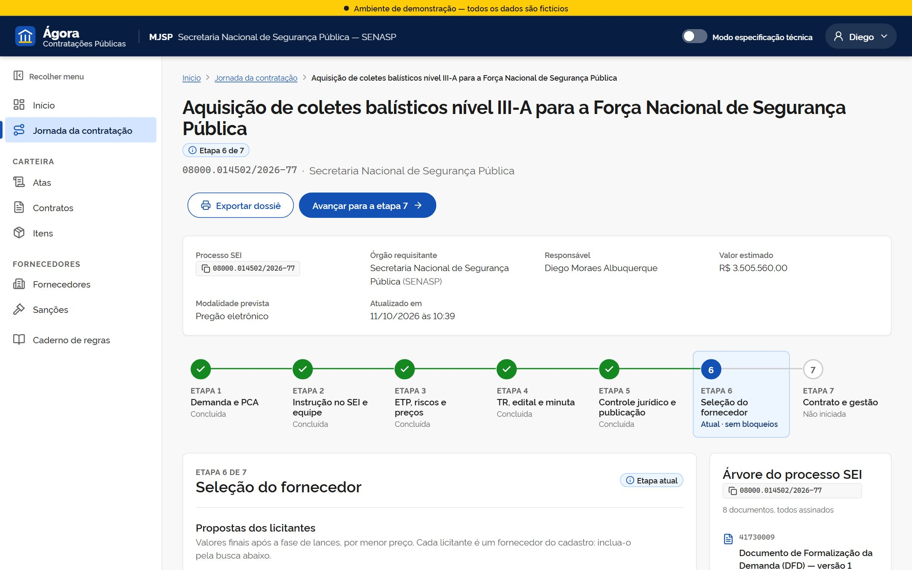

**Etapa 7 — Contrato e gestão.**

1. Clique em **Contratar**.
2. A Ágora verifica sanções e regularidade do fornecedor (art. 91, § 4º).
3. Se tudo estiver em ordem, ela cria o contrato na carteira, com as tarefas do plano de gestão e a pendência de divulgação no PNCP.

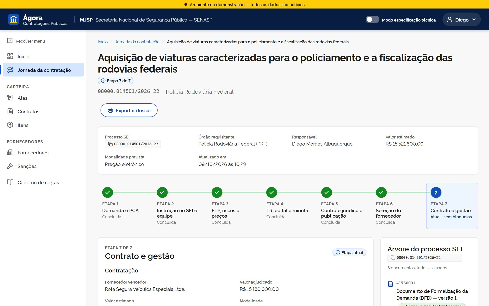

### Exportar o dossiê

1. Clique em **Exportar dossiê**. A Ágora monta, numa só página, os dados do processo, os documentos e as regras aplicadas.
2. Clique em **Imprimir ou salvar em PDF** para gerar o arquivo.
3. Para voltar, clique em **Voltar ao processo**.

## 10. Fornecedores e sanções

### Fornecedores

Em **Fornecedores**, filtre por **Faixa do IDC** e marque **Com sanção vigente**. A página de cada fornecedor mostra:

- o **Índice de Desempenho do Contratado (IDC)**, calculado a partir da execução dos contratos (art. 88, §§ 3º e 4º), com a metodologia explicada;
- os dados cadastrais e a regularidade;
- as abas **Contratos** e **Sanções**.

### Instaurar um processo sancionatório

Perfis: gestor de contratos e administrador.

1. Em **Sanções**, clique em **Instaurar processo**.
2. Busque o fornecedor e escolha o contrato relacionado.
3. Selecione a infração do art. 155 e a sanção em análise.
4. Confirme. A aplicação de qualquer sanção depende de decisão da autoridade competente, depois do contraditório e da ampla defesa.

### Simular a multa (art. 156)

1. No **Simulador de dosimetria da multa**, informe o **Valor do contrato**.
2. Escolha a **Gravidade da infração**.
3. Marque os **Agravantes** e **Atenuantes** que se aplicam. Indique também se há programa de integridade e se houve dano à Administração.
4. Clique em **Calcular proposta**.

O resultado mostra o percentual, o valor proposto da multa, a conferência com os limites legais (de 0,5% a 30%) e a **memória de cálculo**. O simulador não grava nada: é uma proposta para apoiar a decisão da autoridade competente.

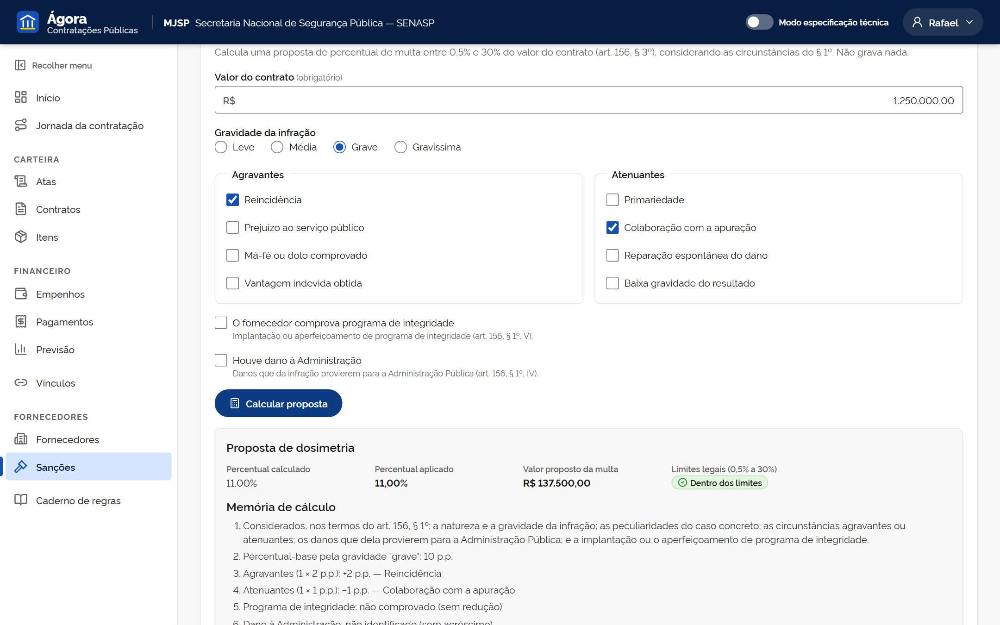

### Simular a multa moratória (art. 162)

A multa de mora é a do atraso injustificado na execução, com o percentual diário e o limite de dias da cláusula do contrato.

1. No **Simulador de multa moratória**, informe o **Valor da parcela em atraso** e os **Dias de atraso**.
2. Confira **Percentual ao dia (%)** e **Limite de dias**. Eles começam com 0,5% e 30 dias e devem seguir a cláusula do contrato.
3. Clique em **Calcular multa moratória**.

O resultado mostra:

- os dias considerados e o percentual aplicado;
- o valor proposto da multa e a memória de cálculo;
- uma etiqueta, quando o atraso passa do teto de dias do contrato.

A multa de mora não impede a conversão em compensatória nem a extinção do contrato com outras sanções. A aplicação continua sendo decisão da autoridade competente, depois do prazo de defesa.

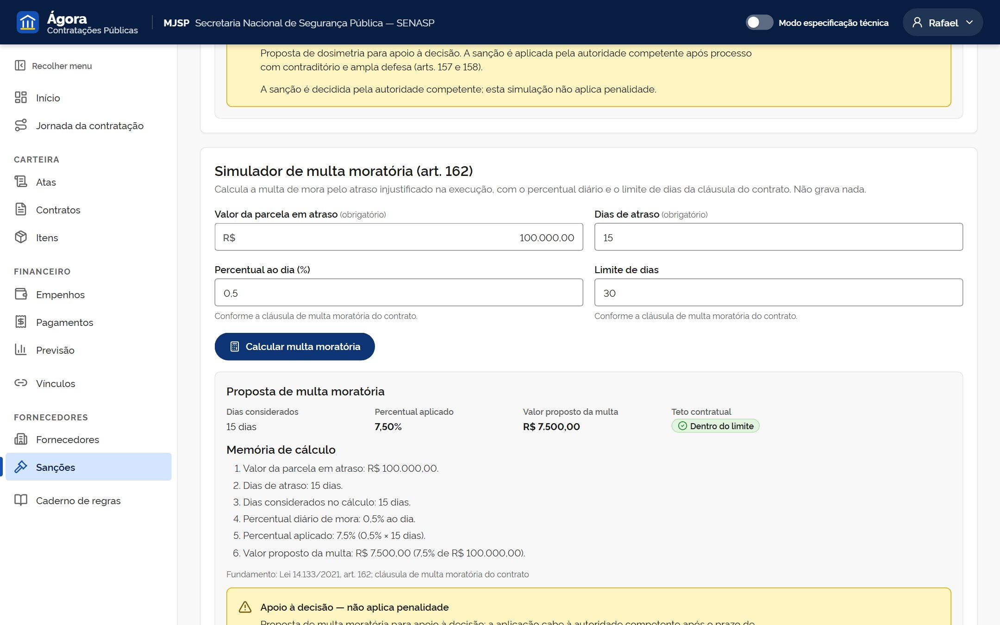

## 11. Dados pessoais (LGPD)

CPF, e-mail e telefone aparecem **mascarados** em todas as telas. Só o auditor e o administrador podem ver o dado completo, e cada acesso fica registrado.

1. Ao lado do dado mascarado, clique em **Revelar**.
2. Em **Finalidade do acesso**, explique para que você precisa do dado (até 300 caracteres), por exemplo: "conferência de documento para emissão de nota de empenho". O campo é obrigatório.
3. Clique em **Revelar e registrar acesso**.

O acesso, com seu nome, data, hora e finalidade, aparece em **Auditoria › Acessos a dados pessoais** (LGPD, art. 37).

## 12. Auditoria

Perfis: auditor e administrador.

A **Trilha de auditoria** registra todas as escritas, acessos e sincronizações. Os filtros são **Buscar no resumo**, **Ação**, **Recurso**, **De** e **Até**. Clique no nome de uma pessoa para ver só as ações dela.

Para confirmar que ninguém alterou o histórico, clique em **Verificar integridade da cadeia**. Cada evento guarda o código (hash) do anterior, e a verificação recalcula a cadeia inteira no servidor. O resultado esperado é **Cadeia íntegra**. Se houver adulteração, a Ágora aponta o primeiro evento divergente.

**Acessos a dados pessoais** lista quem revelou qual dado, quando e com que finalidade.

## 13. Administração

Perfil: administrador. As integrações também podem ser executadas pelo financeiro.

### Usuários

1. Em **Usuários**, clique em **Novo usuário**.
2. Preencha **Nome completo**, **E-mail institucional** e **CPF**. O CPF fica mascarado nas listagens.
3. Marque os **Perfis**.
4. Informe as **UASGs do escopo**: códigos de 6 dígitos, separados por vírgula. Deixe em branco para administrador e auditor, que veem todas as UASGs.
5. Se for o caso, escolha a **Unidade interna** e salve.

Na lista de usuários, cada linha tem os botões **Editar**, **Desativar** e **Gerar senha temporária**. Ao gerar uma senha temporária:

- todas as sessões abertas da pessoa são encerradas;
- a senha aparece **uma única vez**, nessa tela, e expira em 72 horas;
- no primeiro acesso, a pessoa é obrigada a trocá-la.

### Perfis

**Perfis** mostra a tabela completa de permissões por perfil, só para consulta. Para mudar o que uma pessoa pode fazer, altere os perfis dela em **Usuários**.

### Integrações

As sincronizações com PNCP, Compras.gov.br, Contratos.gov.br e SIAFI rodam no servidor da Ágora; o navegador nunca fala com esses sistemas. A tabela mostra a situação, a última execução, o último sucesso e quantos registros foram processados. Para rodar uma sincronização fora do horário programado, use **Executar agora**.

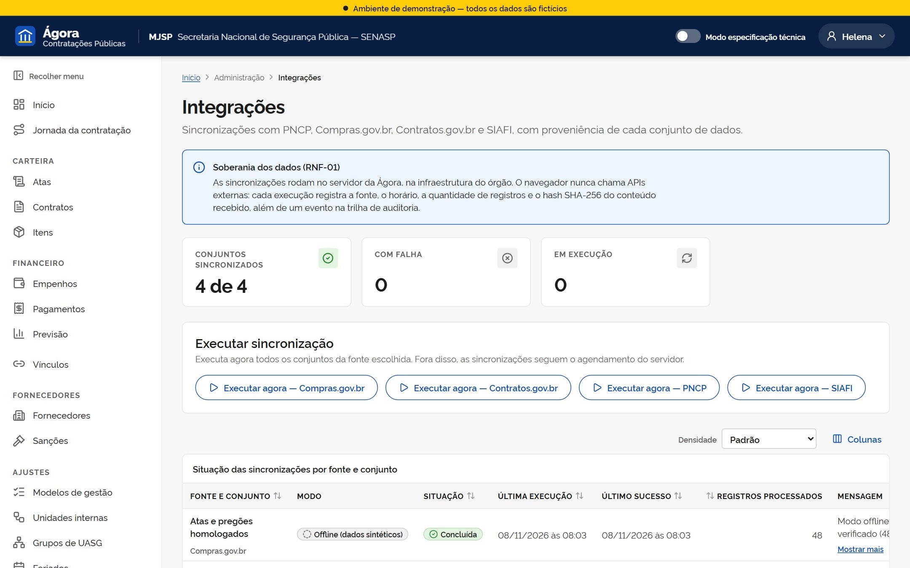

### Ajustes

- **Modelos de gestão:** definem as tarefas criadas automaticamente nos planos de gestão de atas e contratos, como a fiscalização mensal e o reajuste anual.
- **Unidades internas:** as unidades do órgão às quais os usuários pertencem.
- **Grupos de UASG:** grupos usados em compras compartilhadas. Grupos novos aguardam confirmação.
- **Feriados:** o calendário usado na contagem de prazos em dias úteis (art. 183). Os feriados nacionais são calculados automaticamente. Os locais são cadastrados em **Cadastrar feriado local**.

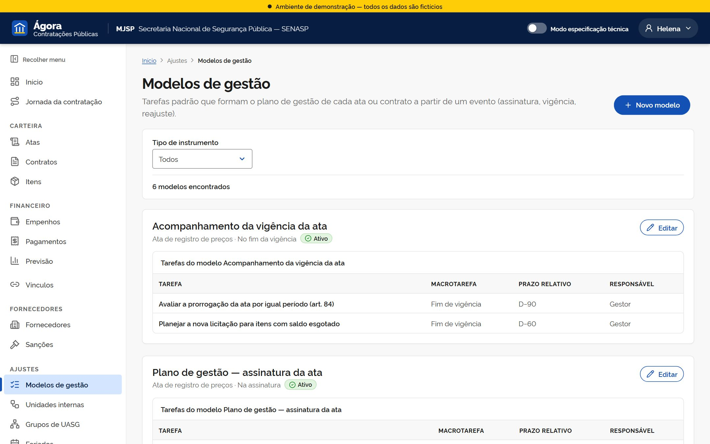

## 14. Recursos para todos os perfis

### Modo especificação técnica

O botão **Modo especificação técnica**, no cabeçalho, mostra em cada tela as regras que ela aplica (requisitos funcionais, regras de negócio e sinais de IA), com o fundamento legal. Ele serve para auditores, para a área jurídica e para quem quer entender por que a Ágora age de determinada forma.

### Caderno de regras

**Caderno de regras** reúne todas as regras da Ágora, organizadas por etapa da jornada, com busca (**Buscar regra**) e filtro por **Tipo**. Use **Imprimir caderno** para gerar uma versão em papel ou PDF.

### Transparência

A página **Transparência** é pública: qualquer cidadão consulta os contratos sem entrar no sistema. Ela não mostra CPF nem e-mail, e fornecedores pessoa física aparecem com o documento mascarado.

### Editais publicados

**Transparência: editais publicados** lista os editais publicados na etapa 5 da jornada. Cada edital tem uma página com os dados da publicação e o **inteiro teor** em PDF: edital, termo de referência e minuta do contrato.

- Os documentos são a última versão aprovada e saem com CPF, e-mail e telefone tarjados.
- O acesso é livre, sem cadastro nem login (art. 25, § 3º).

Quando a publicação for feita no PNCP pela integração do órgão, a página também mostra o link para o registro oficial no portal.

## 15. Dúvidas frequentes

**Não encontro uma opção no menu.**
O menu mostra só o que o seu perfil permite. Peça ao administrador para revisar seus perfis e seu escopo de UASGs.

**Esqueci a senha ou a entrada foi bloqueada.**
Depois de 5 tentativas erradas, espere 15 minutos. Se esqueceu a senha, o administrador gera uma senha temporária, que vale por 72 horas e precisa ser trocada no primeiro acesso.

**O processo não avança de etapa.**
Leia o aviso: ele lista cada regra não atendida, com a explicação e o artigo da lei. Resolva no painel da etapa e tente de novo. Sinais não impedem o avanço; bloqueios impedem.

**A IA toma decisões?**
Não. A IA, quando o órgão a habilita, só redige rascunhos e aponta sinais, sempre com fontes e com revisão humana obrigatória. Habilitação, sanção, multa, conclusão do parecer e qualquer impedimento são sempre decisão de uma pessoa. Por padrão, a Ágora funciona sem IA nenhuma.

**Dá para desfazer uma ação?**
Resolver pendência e vincular instrumentos têm **Desfazer** no aviso. O atesto de nota fiscal não pode ser desfeito pela tela. Toda ação, desfeita ou não, fica na trilha de auditoria.

**Apareceu um erro com "Código para o suporte".**
Copie o código e envie ao suporte do seu órgão. Ele permite localizar exatamente o que aconteceu, sem expor seus dados.
