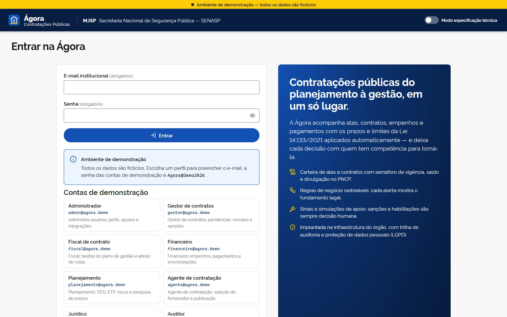
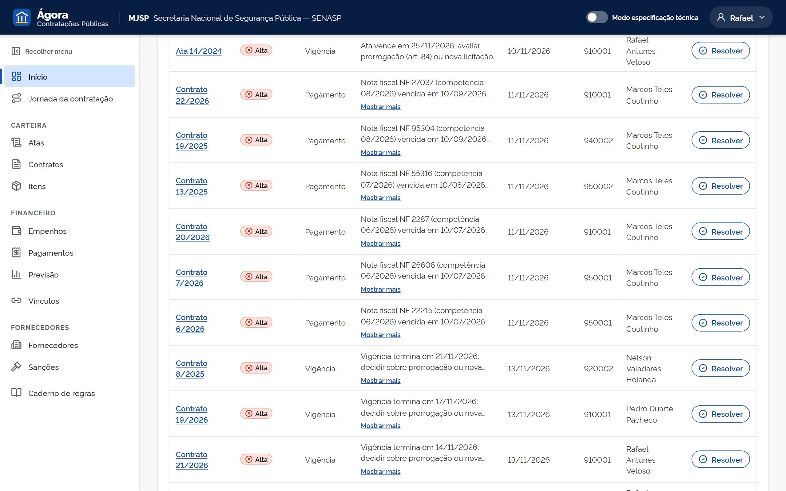
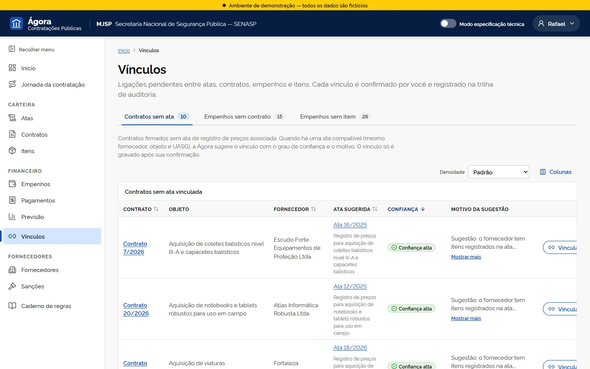
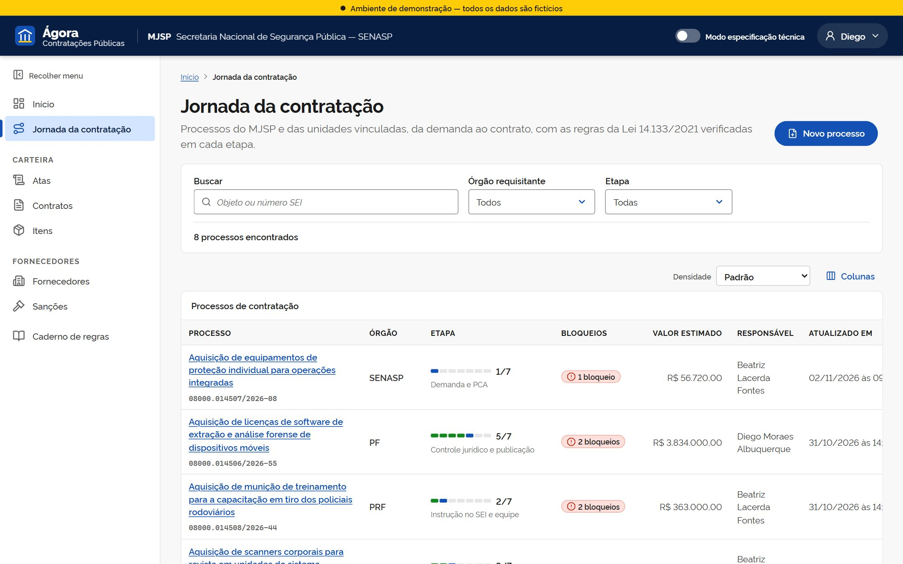
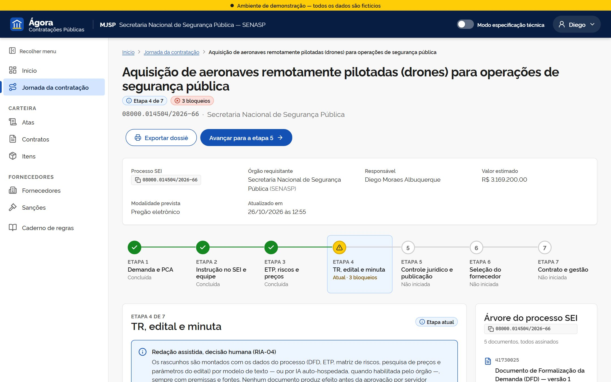
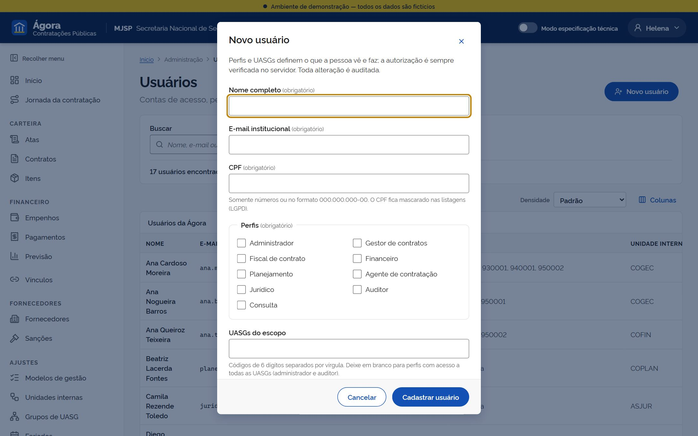
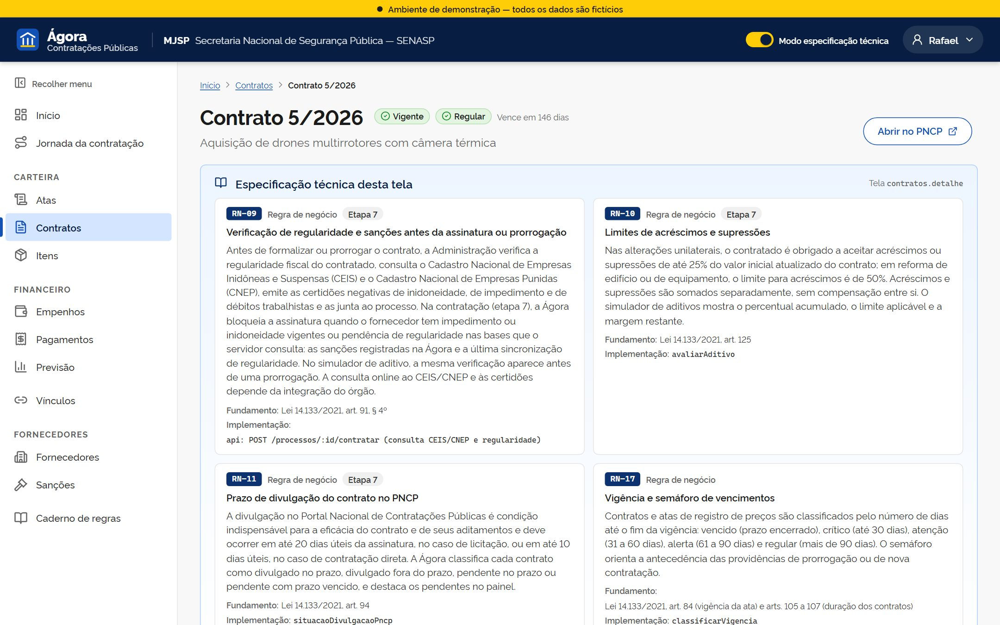
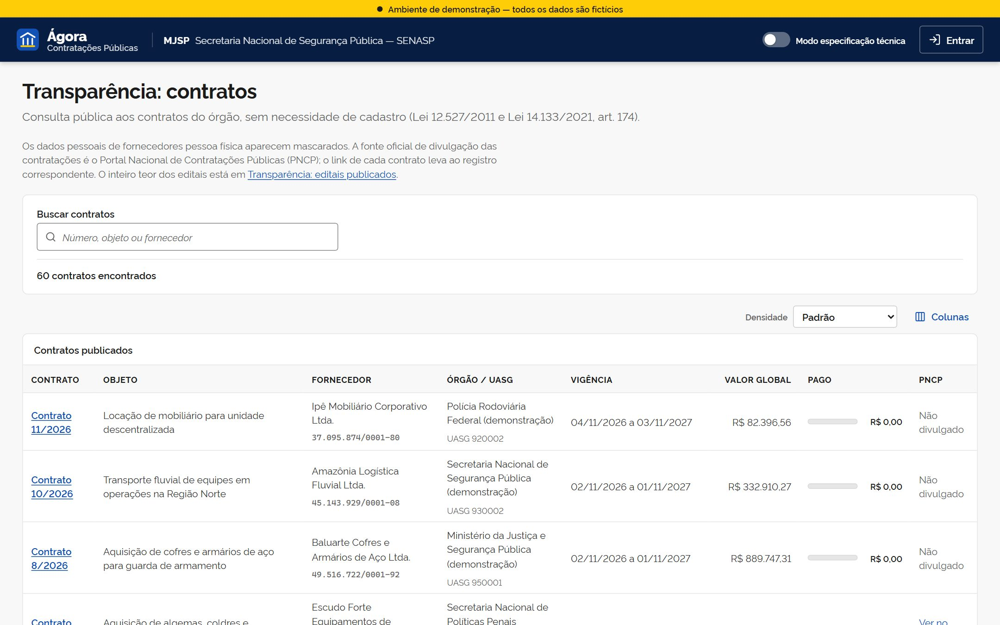

# Manual do usuário da Ágora

Este manual mostra como usar a Ágora no dia a dia. Cada seção trata de uma tarefa e diz quais perfis podem fazê-la. Os nomes de botões e campos aparecem em **negrito**, como na tela.

As telas deste manual vêm do ambiente de demonstração, com dados fictícios. No ambiente do seu órgão, os dados serão os reais e o menu mostrará apenas o que o seu perfil permite.

## 1. Entrar, trocar a senha e sair

### Entrar

1. Abra o endereço da Ágora informado pelo seu órgão.
2. Preencha **E-mail institucional** e **Senha**. O botão **Mostrar senha** exibe o que você digitou.
3. Clique em **Entrar**.

Se o órgão tiver habilitado o Login Único gov.br, a tela de entrada mostra também a opção de entrar com a conta gov.br.

> **Atenção:** depois de 5 tentativas com senha errada, a entrada fica bloqueada por 15 minutos. Se você esqueceu a senha, peça ao administrador da Ágora no seu órgão uma senha temporária.

### Primeiro acesso e senha temporária

Quando o administrador gera uma senha temporária para você, ela vale por 72 horas. No primeiro acesso, a Ágora pede a troca de senha antes de qualquer outra tela.

### Trocar a senha

1. No canto superior direito, clique no seu nome. O menu mostra seu nome completo, seus perfis e o escopo de UASGs que você pode ver.
2. Clique em **Trocar senha**.
3. Preencha **Senha atual**, **Nova senha** e **Confirmar nova senha**. A nova senha precisa ter pelo menos 12 caracteres e ser diferente da atual. Uma frase longa e fácil de lembrar é a melhor escolha.
4. Clique em **Trocar senha**. A lista de requisitos abaixo dos campos mostra o que ainda falta.

### Sair

Clique no seu nome e depois em **Sair**. Por segurança, a sessão também expira sozinha. Quando isso acontece, a Ágora pede que você entre de novo e depois volta para a tela em que você estava.

## 2. Conhecendo a tela

- **Faixa amarela no topo:** aparece só nos ambientes de demonstração e de homologação, para lembrar que os dados não são reais.
- **Cabeçalho:** a marca da Ágora leva ao início. Ao lado ficam o nome do órgão, o botão **Modo especificação técnica** (seção 17) e o menu com o seu nome.
- **Menu lateral:** organizado em grupos (Carteira, Financeiro, Fornecedores e outros). **Recolher menu** deixa só os ícones, para ganhar espaço. Itens que o seu perfil não pode usar não aparecem.
- **Área principal:** no alto fica o caminho da página (por exemplo, "Início › Contratos"), que serve para voltar. Abaixo dele vêm o título e os botões de ação da página.

### Tabelas, buscas e filtros

As listas da Ágora funcionam todas do mesmo jeito:

- **Buscar** e os filtros ficam acima da tabela. O número de resultados é atualizado a cada filtro.
- Clique no título de uma coluna para ordenar por ela.
- **Colunas** escolhe quais colunas aparecem. **Densidade** deixa a tabela mais compacta ou mais espaçada. **Itens por página** e os botões de página ficam no rodapé da tabela.
- Os filtros ficam guardados no endereço da página. Para mostrar a mesma lista a um colega, basta enviar o link.

### Avisos e erros

- Depois de uma ação, um aviso confirma o que foi feito. Algumas ações oferecem **Desfazer** no próprio aviso.
- Quando algo dá errado, a mensagem explica o problema e mostra um **Código para o suporte**. Envie esse código ao suporte do seu órgão: ele identifica exatamente o que aconteceu.

### No celular

No celular, o menu lateral vira o botão **Menu**, e cada linha das tabelas vira um cartão com as informações principais.

 

### Acessibilidade

A Ágora segue o Padrão Digital de Governo e pode ser usada só pelo teclado: **Tab** avança, **Shift+Tab** volta e **Esc** fecha janelas. O primeiro item da página, **Ir para o conteúdo principal**, pula direto para o conteúdo. A tela funciona com zoom de até 200% e com leitores de tela.

## 3. O que cada perfil pode fazer

O que você vê e faz depende de dois controles, ambos verificados pelo servidor a cada ação:

- os seus **perfis**;
- o seu **escopo de UASGs**, isto é, as unidades cujos dados você pode ver.

| Perfil | Principais tarefas |
|---|---|
| Gestor de contratos | Acompanha atas e contratos, resolve pendências, conclui tarefas do plano de gestão, vincula instrumentos e instaura processos sancionatórios. Consulta a jornada da contratação. |
| Fiscal de contrato | Cumpre as tarefas do plano de gestão, resolve pendências, registra medições do IMR e **atesta notas fiscais** após conferência. |
| Financeiro | Acompanha empenhos, pagamentos e a previsão, vincula empenhos e executa as sincronizações com os sistemas do governo. |
| Planejamento | Conduz a fase preparatória da jornada: DFD, ETP, matriz de riscos, dotação orçamentária e pesquisa de preços. |
| Agente de contratação | Conduz a seleção do fornecedor, a sala de disputa, os atos da seleção e **publica** editais e avisos no PNCP e no DOU. |
| Assessoria jurídica | Faz o controle prévio de legalidade (art. 53), analisa pareceres em alterações contratuais e registra manifestações. |
| Controle interno | Acompanha a 2ª linha de defesa: medidas de controle externo, matriz de achados preventivos, auditor contínuo e revisões trimestrais de riscos. |
| Auditor | Consulta tudo, verifica a integridade e o carimbo de tempo da trilha de auditoria e acompanha os acessos a dados pessoais. Pode revelar dados pessoais, com finalidade registrada. |
| Cidadão | Acessa a gestão compartilhada com a sociedade pelo Login Único gov.br para enviar manifestações sobre contratos em execução. |
| Consulta | Somente leitura dos instrumentos e da execução financeira das UASGs autorizadas. |
| Administrador | Cuida de usuários, perfis, fila de integrações, ajustes e operação sustentável. Tem todas as permissões. |

A tabela completa de permissões está em **Administração › Perfis** (para o administrador). Se você precisa de uma função que não aparece no seu menu, peça ao administrador para ajustar os seus perfis.

## 4. Início, pendências e linha do tempo

A tela **Início** reúne o que pede atenção na carteira:

- indicadores e vencimentos em 30, 60, 90 e 120 dias;
- contratos com prazo de divulgação no PNCP vencido (art. 94);
- contratos com queima de saldo acelerada;
- os próximos vencimentos e a linha do tempo.

Cada conjunto de dados informa a fonte e o horário da última atualização. Enquanto carrega, a tela mostra blocos cinzas no formato do conteúdo; números zerados durante o carregamento não acontecem.

### Linha do tempo dos vencimentos e semáforo de 120 dias

O painel inicial apresenta o **Semáforo de vigência** e a **Linha do tempo de vencimentos** para contratos e atas de registro de preços nos próximos 120 dias (RN-31):

- **Regular:** mais de 120 dias restantes.
- **Planejamento (91 a 120 dias):** alerta para iniciar estudos de prorrogação ou planejamento de nova contratação.
- **Alerta (61 a 90 dias):** providências de prorrogação ou instrução licitatória em andamento.
- **Atenção (31 a 60 dias):** prazos críticos para assinaturas e publicação de aditivos.
- **Crítico (até 30 dias):** aviso prioritário e obrigatório para gestores e fiscais.
- **Vencido:** vigência encerrada.

A varredura diária do servidor consolida os instrumentos em cada faixa e gera pendências e notificações automáticas dirigidas aos responsáveis.

### Resolver uma pendência

Perfis: gestor de contratos, fiscal de contrato e administrador.

1. Em **Fila de pendências**, use os filtros **Tipo**, **Prioridade**, **Situação** e **UASG**, ou marque **Somente as minhas**.
2. Na linha da pendência, clique em **Resolver**.
3. Em **Observação da resolução**, explique o que foi feito (até 500 caracteres), por exemplo: "Termo aditivo de prorrogação assinado em 05/11". O campo é obrigatório.
4. Clique em **Resolver pendência**. Se você se enganou, clique em **Desfazer** no aviso que aparece.

A resolução fica no histórico do contrato ou da ata e na trilha de auditoria.

## 5. Contratos

Em **Contratos**, filtre por **Situação** e **UASG**, ou marque **Sob minha gestão** e **Sem ata de origem**. Clique no número do contrato para abri-lo.

A página do contrato mostra:

- **Resumo do contrato** e **Linha do tempo**, da assinatura ao fim da vigência;
- **Divulgação no PNCP:** situação e prazo do art. 94;
- **Queima de saldo:** ritmo de execução e projeção de quando o saldo acaba;
- **Garantia contratual.**

Os botões ao lado do número copiam o número do processo e o identificador do PNCP. **Abrir no PNCP** abre o registro oficial em outra aba. O botão **Notificar** no topo abre o disparo direto de avisos.

As abas trazem a gestão completa:

- **Plano de gestão:** tarefas de fiscalização e gestão, geradas pelos modelos de gestão. Gestor e fiscal usam **Concluir tarefa** e **Reabrir tarefa**.
- **Itens, Empenhos e Pagamentos:** a execução física e financeira do contrato.
- **Alterações do contrato:** histórico de aditivos, apostilas, reajustes, repactuações, reequilíbrios e extinção (RF-27).
- **IMR e medições:** indicadores de nível de serviço, medições mensais e glosas (RF-29).
- **Avaliação de desempenho:** ocorrências registradas, emissão do documento da avaliação e manifestação do contratado (RN-37, RF-30).
- **Matriz de riscos:** acompanhamento dos riscos e registro das revisões trimestrais obrigatórias (RN-29).
- **Histórico:** tudo o que aconteceu com o contrato, inclusive as pendências resolvidas.

### Aba Alterações do contrato (RF-27)

Perfis: gestor de contratos, assessoria jurídica, autoridade competente e administrador.

A aba **Alterações** reúne todos os atos que modificam o contrato original:

1. **Termo aditivo (art. 125, RN-32):**
   - Informe o **Tipo de alteração** (acréscimo ou supressão), o **Valor** e a justificativa.
   - O simulador confere os limites legais acumulados (até 25% para compras e serviços ou 50% para reforma de edifícios/equipamentos). A API recusa alterações que extrapolem a margem legal.
   - Antes da assinatura pela autoridade competente, o servidor executa o checklist de regularidade fiscal e trabalhista e consulta ao CEIS/CNEP (RN-09).
   - O termo aditivo aprovado gera PDF oficial para juntada e entra na fila de publicação do PNCP no prazo de 20 dias úteis (art. 94).
2. **Prorrogação de vigência (arts. 105 a 114, RN-33):**
   - A prorrogação respeita os limites da vigência máxima da natureza do objeto (serviços e fornecimentos contínuos até 10 anos, sistemas de TI até 15 anos).
   - Exige crédito orçamentário registrado, justificativa de vantajosidade e checklist de regularidade.
3. **Apostilamento de reajuste e repactuação:**
   - **Reajuste:** apostilado após decorridos 12 meses da data do orçamento estimado, aplicando o índice oficial estipulado no contrato.
   - **Repactuação:** motivada por variação analítica nos componentes de custos para serviços com dedicação exclusiva de mão de obra.
4. **Reequilíbrio econômico-financeiro (art. 124, II, "d"):**
   - Registra a instrução probatória para restabelecer a relação inicial entre encargos e retribuição, motivada por fatos imprevisíveis ou previsíveis de efeitos incalculáveis, confrontada com a matriz de riscos do contrato.
5. **Processo de extinção contratual (arts. 137 a 139):**
   - O gestor pode instaurar a extinção motivada (unilateral, consensual ou determinada por decisão judicial/arbitral).
   - Na extinção unilateral, a Ágora assegura o contraditório notificando o contratado para defesa prévia escrita. A decisão final motivada cabe à autoridade competente, que delibera sobre retenção de créditos e sanções cabíveis.

### Aba IMR e medições periódicas (RF-29)

Perfis: gestor de contratos e fiscal de contrato.

1. **Configuração de indicadores:** o gestor cadastra cada indicador do Instrumento de Medição de Resultado (nome, meta percentual, periodicidade, itens vinculados e faixas de glosa).
2. **Registro de medição mensal:** o fiscal do contrato lança o resultado da competência com o documento comprobatório. A Ágora calcula a pontuação e a retenção financeira (glosa) com memória de cálculo determinística.
3. **Alerta sancionatório:** medições em faixa crítica abrem pendência automática para o gestor avaliar o encaminhamento para processo sancionatório.

### Aba Avaliação de desempenho e ocorrências (RN-37, RF-30)

Perfis: gestor de contratos e fiscal de contrato.

1. **Ocorrências da execução:** o fiscal registra notificações operacionais, atrasos e falhas técnicas com prazo para saneamento.
2. **Emissão da avaliação periódica:** o gestor emite a avaliação calculada objetivamente pelos indicadores apurados (entregas pontuais, atestos sem ressalva e ocorrências saneadas), sem atribuição de nota subjetiva.
3. **Manifestação do contratado:** o fornecedor é notificado para se manifestar em 5 dias úteis. Após a análise fundamentada, a avaliação é concluída e passa a integrar o registro cadastral, com emissão do documento comprobatório em PDF com protocolo.

### Revisão trimestral da matriz de riscos (RN-29)

Perfis: gestor de contratos, fiscal de contrato e controle interno.

A matriz de riscos de cada contrato deve ser revisada a cada 3 meses:
1. Abra a aba **Matriz de riscos** no contrato.
2. O sistema indica o vencimento da revisão, com alerta antecipado de 15 dias.
3. Clique em **Revisar riscos**, atualize a probabilidade e o impacto de cada risco e registre a observação técnica da equipe. A revisão fica registrada na trilha de auditoria.

### Notificar contratada ou fiscais (RF-26)

Perfis: gestor de contratos e fiscal de contrato.

No topo da página do contrato, clique em **Notificar**:
1. Escolha o destinatário (empresa contratada, gestor ou fiscal).
2. Selecione o canal de envio (**E-mail institucional**, **SEI** ou **gov.br**).
3. Preencha o assunto e o texto da notificação. A mensagem é processada pela fila assíncrona com registro na trilha de auditoria.

## 6. Atas de registro de preços e itens

Em **Atas**, a aba **Registradas** lista as atas vigentes e encerradas, e a aba **A montar** lista as que ainda estão em preparação. Os filtros são **Situação**, **Criticidade**, **UASG** e **Sob minha gestão**. A coluna **Consumo** mostra quanto da ata já foi contratado.

A página da ata mostra os dados, a linha do tempo e as abas **Plano de gestão**, **Itens**, **Contratos vinculados**, **Reajuste** e **Histórico**.

Em **Itens** fica a carteira de itens de todas as atas e contratos, com os filtros **UASG**, **Alocação em contrato** e **Empenho**. O botão **Exportar CSV dos itens filtrados** baixa a lista para abrir numa planilha.

## 7. Financeiro

### Empenhos

Em **Empenhos**, filtre por **Saldo**, **Restos a pagar**, **Ano de emissão** e **UASG**. A tabela mostra o valor empenhado, o valor pago e o saldo de cada nota de empenho.

### Pagamentos e atesto de notas fiscais

**Pagamentos** segue a ordem cronológica de pagamentos por fonte de recurso (art. 141). A coluna **Ordem** mostra a posição de cada parcela.

Para atestar uma nota fiscal (perfis fiscal de contrato e administrador):

1. Na linha da nota, clique em **Atestar**.
2. Confira nota fiscal, contrato, fornecedor, competência, vencimento e valor.
3. Se o contrato tiver IMR configurado, a tela exige a conferência da nota fiscal com a medição do período.
4. O servidor realiza o recheque automático de regularidade no CEIS/CNEP e certidões fiscais.
5. Clique em **Atestar pagamento**.

> **Atenção:** ao atestar, você confirma que o objeto foi entregue ou executado conforme o contrato (art. 140). O atesto fica na trilha de auditoria e **não pode ser desfeito por esta tela**.

### Conferência da nota fiscal com IMR antes do atesto (RN-36)

Perfis: fiscal de contrato e financeiro.

1. Ao registrar a nota fiscal vinculada ao contrato, preencha número, data de emissão, valor total e itens recebidos.
2. A Ágora confronta a nota com as medições do IMR da competência:
   - Valor devido = (Preço unitário contratado × Quantidade recebida) − Glosa do IMR.
3. Se houver divergência entre o valor faturado e o valor devido, ou medição pendente, o atesto é bloqueado.
4. Para atestar com divergência, o fiscal deve justificar expressamente em campo próprio o motivo da autorização.

### Recheque de regularidade no atesto e no pagamento (RN-23)

Perfis: fiscal de contrato e financeiro.

1. Antes de cada atesto e antes do pagamento pelo financeiro, o sistema consulta a situação do fornecedor no CEIS e CNEP e a validade das certidões fiscal federal, do FGTS e trabalhista.
2. Caso seja apontada irregularidade, o atesto prossegue com registro formal de ressalva, abrindo pendência automática para notificação da empresa.
3. A irregularidade fiscal superveniente não impede o pagamento pelos serviços ou bens já prestados e atestados, cabendo à autoridade instaurar processo sancionatório se a mora persistir.

### Previsão de pagamentos

Escolha o **Exercício**. O gráfico compara o previsto e o realizado de cada mês, e a tabela abaixo dele detalha o previsto e o realizado de cada contrato no ano.

## 8. Vínculos

Perfis que podem vincular: gestor de contratos, financeiro e administrador.

**Vínculos** junta o que ficou solto na carteira, em três abas:

- **Contratos sem ata**
- **Empenhos sem contrato**
- **Empenhos sem item**

O número ao lado de cada aba mostra quantos casos há. A Ágora sugere o vínculo mais provável e mostra o grau de **Confiança** da sugestão.

1. Confira a sugestão na linha.
2. Clique em **Vincular** e confirme. O consumo da ata e o saldo contratável são recalculados.
3. Se precisar, use **Desfazer** no aviso que aparece em seguida.

## 9. Jornada da contratação

A jornada conduz cada contratação pelas 7 etapas da Lei 14.133/2021:

1. Demanda e PCA
2. Instrução no SEI e equipe
3. ETP, riscos e preços
4. TR, edital e minuta
5. Controle jurídico e publicação
6. Seleção do fornecedor
7. Contrato e gestão

Quem trabalha em cada etapa:

- **Planejamento e agente de contratação:** editam o processo.
- **Assessoria jurídica:** registra o parecer.
- **Agente de contratação:** publica.
- **Gestor e auditor:** acompanham, sem editar.

### Criar um processo

1. Em **Jornada da contratação**, clique em **Novo processo**.
2. Informe o **Objeto** (título do processo) e o **Órgão requisitante**.
3. Clique em **Criar processo**. O processo começa na etapa 1, com número SEI gerado pela Ágora.

### Como ler a página do processo

- **Faixa de etapas:** mostra onde o processo está. Etapas concluídas têm um sinal de confirmação, e etapas com problema têm um alerta.
- **Painel da etapa:** os formulários e documentos daquela fase.
- **Árvore do processo SEI:** os documentos numerados e as assinaturas.
- **Bloqueios:** regras da lei que **impedem** o avanço até serem resolvidas.
- **Sinais:** pontos de **atenção** que não impedem o avanço, como "demanda fora do PCA". Um sinal pede análise humana e nunca é uma acusação.

### Avançar de etapa

1. Clique em **Avançar para a etapa N** e confirme em **Avançar etapa**.
2. O servidor confere todas as regras da etapa. Se alguma não estiver atendida, o processo **permanece na etapa** e o aviso lista cada regra, com a explicação e o fundamento legal.
3. Resolva os bloqueios no painel da etapa e tente de novo.

### O que fazer em cada etapa

**Etapa 1 — Demanda e PCA.** Preencha o DFD:

- **Descrição da necessidade**, **Justificativa da contratação** e **Natureza do objeto**;
- os **Itens da demanda**, usando **Adicionar item**;
- a marcação **Demanda prevista no Plano de Contratações Anual (PCA)**;
- **Lições aprendidas de contratações anteriores (RIA-12):** a Ágora pesquisa contratos anteriores do órgão com objetos semelhantes e apresenta ocorrências, atrasos e boas práticas como sugestões de cláusulas. O planejador avalia e decide se incorpora cada sugestão ao DFD.

Se algum item não estiver no catálogo padronizado (CATMAT/CATSER), a justificativa é obrigatória (art. 19, § 2º). A trava de artigo de luxo (RN-01, art. 20) identifica automaticamente bens com características suntuosas e bloqueia o avanço da etapa e a geração de minutas até que o responsável registre justificativa formal demonstrando a qualidade comum do objeto. A Ágora também sinaliza quando a soma das dispensas no exercício se aproxima do limite legal (art. 75, § 1º). Clique em **Salvar DFD**.

**Etapa 2 — Instrução no SEI e equipe.**

1. Em **Designação da equipe**, use **Adicionar designação** para indicar requisitante, equipe de planejamento, agente de contratação, comissão de contratação e autoridade competente.
2. **Segregação de funções (art. 7º, § 1º):** se a mesma pessoa for designada para funções inconciliáveis (como agente de contratação e fiscal), o sistema barra a confirmação.
3. **Declaração de inexistência de impedimentos (RN-28):** cada agente designado assina formalmente declaração de que não possui vínculo de parentesco até 3º grau, relação comercial ou conflito de interesses com licitantes habituais, além de comprovar vínculo permanente e capacitação para funções essenciais. Agentes sem declaração válida não podem atuar no processo.
4. **Integração com o SEI (RF-35):** clique em **Enviar processo ao SEI**. O sistema gera o processo no SEI do órgão via web service (SeiWS), insere os documentos aprovados na árvore e cria o bloco de assinaturas. Os servidores assinam no próprio SEI com certificado digital ICP-Brasil e a Ágora sincroniza as assinaturas.

**Etapa 3 — ETP, riscos e preços.**

- **ETP (art. 18):** preencha os 13 incisos do estudo técnico preliminar. Os incisos I, IV, VI, VIII e XIII são de preenchimento obrigatório por lei.
- **Sustentabilidade e logística reversa obrigatórias (RN-21):** em conformidade com a política do órgão (art. 5º e art. 11, IV), o preenchimento de critérios ecológicos, consumo sustentável e logística reversa de refugos é obrigatório no ETP e no TR para avanço e aprovação.
- **Dotação orçamentária estruturada (RN-39):** informe a dotação em campos padronizados: unidade gestora, programa de trabalho, natureza da despesa, fonte e exercício financeiro.
- **Lições aprendidas (RIA-12):** consulte as sugestões de mitigação de riscos baseadas em execuções contratuais anteriores e incorpore as premissas pertinentes ao ETP.
- **Matriz de riscos:** registre os riscos da contratação com **Incluir risco**. O mapa de calor confronta probabilidade × impacto e aponta as ações preventivas e alocação de responsabilidades.
- **Pesquisa de preços (art. 23):**
  - **Consulta automática de preços (RF-25):** clique em **Consultar fontes oficiais**. O servidor busca preços públicos no Painel de Preços, contratações similares do governo federal, notas fiscais eletrônicas e bases Sinapi/Sicro para serviços de engenharia. Cada amostra é enquadrada no inciso do art. 23 e o planejador escolhe quais cotações incluir.
  - **Projeção cambial e inflacionária (RIA-11):** o sistema projeta o valor estimado até a data prevista da contratação com base na variação do IPCA (IBGE) e taxa média do dólar (Banco Central) para itens importados.
  - Registre cotações manuais com **Incluir cotação** ou importe uma planilha completa.
  - A Ágora calcula média, mediana e menor preço, apontando **Expurgos sugeridos** pelo método Tukey ou percentual (RIA-03). O botão **Marcar todas as sugestões** permite aceitar os expurgos com uma única justificativa registrada.
  - Marque **Orçamento sigiloso** caso a divulgação prévia possa comprometer a disputa (art. 24), informando a motivação técnica.

**Importar a cesta de uma planilha.**

1. Na cesta de preços, clique em **Importar planilha**. Se precisar, use **Baixar modelo de planilha (CSV)**.
2. Escolha o arquivo em **Arquivo da planilha** ou cole as linhas copiadas da planilha em **Conteúdo da planilha**.
   - Colunas: fonte, identificação, valor unitário, data da cotação e justificativa (obrigatória na pesquisa direta com fornecedor).
   - A fonte aceita o código, o nome ou o inciso do art. 23, § 1º (I a V).
3. Escolha se as cotações vão ser **acrescentadas** às atuais ou **substituí-las**.
4. Clique em **Conferir planilha**. O servidor confere cada linha e mostra a prévia, com os erros de cada linha. Nada é gravado nesse passo.
5. Com todas as linhas válidas, clique em **Importar**. A análise estatística é recalculada e os expurgos sugeridos aparecem para o seu aceite.

**Etapa 4 — TR, edital e minuta.**

1. Em **Parâmetros do edital**, defina **Critério de julgamento**, **Modo de disputa** e **Regime de execução**.
2. **Prova de conceito ou amostra (RN-20):** marque se a licitação exige prova de conceito ou amostra do primeiro colocado provisório, definindo o roteiro de testes e o prazo para realização em sessão gravada (até 5 dias úteis).
3. **Qualificação técnica e financeira (RN-25):** a exigência de atestados técnicos fica limitada a parcelas de maior relevância (valor ≥ 4% do total estimado), com quantitativo mínimo não superior a 50% da parcela. O balanço patrimonial restringe-se aos 2 últimos exercícios sociais (ou último exercício para empresas com menos de 2 anos).
4. **Desempenho pretérito na pontuação técnica (RN-37):** no julgamento por técnica e preço, admite-se a valoração do histórico de desempenho obtido no registro cadastral.
5. **Estrutura de IMR (RF-29):** configure as metas, indicadores e percentuais de retenção financeira (glosa) que farão parte das cláusulas de pagamento do TR.
6. **Declaração de adequação orçamentária (RN-39, RF-32):** a autoridade competente designada aprova a declaração de disponibilidade orçamentária antes da publicação do edital.
7. **Documentos complementares da fase preparatória (RF-32):** gere a portaria de designação, o despacho de autorização da contratação e a nota técnica de encaminhamento à CONJUR com quesitos objetivos de controle de legalidade.
8. **Ancoragem normativa e conferência de citações (RNF-08, RIA-14):** as minutas são geradas sobre os modelos padronizados da AGU e ancoradas na base compilada da Lei 14.133/2021. A ferramenta confere se cada dispositivo citado existe e está em vigor, medindo a precisão normativa do documento (IMR-02).
9. **Conferência cruzada entre documentos (RIA-15):** a Ágora compara DFD, ETP, riscos, preços, TR e edital, apontando divergências em prazos, valores, quantitativos e objeto.
10. Clique em **Salvar parâmetros** e em **Gerar rascunho**. Todo documento gerado requer revisão e aprovação humana registrada.

**Documentos do processo e de habilitação (RF-21, RIA-08)**

Perfis: planejamento e agente de contratação.

- **Armazenamento seguro (RF-21):** o envio de documentos aceita formatos PDF, PNG e JPEG. O servidor valida o tipo real pelo conteúdo (não pela extensão), bloqueia códigos ativos ou executáveis, calcula o hash SHA-256 e armazena os arquivos de forma isolada fora do banco com controle de acesso por UASG.
- **Leitura assistida de atestados por OCR (RIA-08):** em documentos digitalizados sem camada de texto, o serviço de OCR em contêiner isolado local analisa o arquivo, localiza os quantitativos executados por item, a unidade e o trecho-fonte (página e linha), confrontando o total somado com os mínimos exigidos pelo edital. A leitura gera um sinal analítico; a decisão de habilitação é privativa do agente de contratação.

**Sigilo de segurança pública (RN-40, RF-33, RNF-09)**

Perfis: planejamento, agente de contratação e autoridade competente.

1. **Classificação formal da informação:** processos e anexos que envolvam segurança pública ou atividades de inteligência podem ser classificados nos graus **Reservado** (5 anos), **Secreto** (15 anos) ou **Ultrassecreto** (25 anos) pela autoridade competente, com fundamentação na LAI (Lei 12.527/2011) e indicação do termo final.
2. **Credenciamento de servidores:** o acesso a documentos sigilosos é concedido nominalmente pela autoridade a servidores que assinam o Termo de Manutenção de Sigilo.
3. **Cofre cifrado de anexos (RNF-09):** peças confidenciais são armazenadas em cofre criptografado em repouso com algoritmo AES-256-GCM.
4. **Download com marca de segurança:** ao baixar um documento sigiloso, o sistema estampa nos cabeçalhos e rodapés o grau de sigilo, código de indexação e identidade de quem baixou, registrando o acesso na auditoria.

**Etapa 5 — Controle jurídico e publicação.**

1. A assessoria jurídica preenche o checklist do **Parecer jurídico (art. 53)**, avaliando cada aspecto formal da instrução e emitindo conclusão privativa.
2. **Publicação no PNCP pela fila de integrações (RF-19):** após parecer favorável, o agente clica em **Publicar no PNCP**. O envio é enfileirado no serviço de mensageria com idempotência, protocolo oficial devolvido e link público sem login.
3. **Publicação no Diário Oficial da União (RF-36):** a Ágora formata o aviso de licitação no padrão oficial da Seção 3 do DOU e calcula a data prevista de veiculação. O servidor credenciado transmite a matéria pelo sistema INCom e registra o número do protocolo. O sistema confere a veiculação no DOU e registra a publicação em jornal de grande circulação.

**Etapa 6 — Seleção do fornecedor.**

Perfis: agente de contratação e autoridade competente.

1. **Sala de disputa eletrônica (RF-22, RN-26):**
   - **Simulação de lances (treino e PoC-03):** permite executar sessões nos modos aberto, aberto e fechado ou fechado e aberto. Participantes cadastrados ou licitantes sintéticos enviam ofertas, respeitando intervalos mínimos e prorrogações sucessivas de 2 minutos caso haja lance na reta final. O agente pode acelerar o relógio da simulação para testes e homologação.
   - **Acompanhamento da sessão oficial:** em compras realizadas pelo Compras.gov.br, o servidor da Ágora acompanha a sessão pública oficial e transcreve lances para consolidação da ata.
   - **Sinais de padrão de lances (RIA-09):** o sistema aponta automaticamente ofertas em intervalos idênticos, reduções fixas sucessivas e alternância de lances entre empresas suspeitas para análise do pregoeiro.
2. **Sinais de vínculos societários e impedimentos (RN-27, RIA-10):** a Ágora cruza o QSA oficial da Receita Federal com os vínculos declarados pelos agentes, apontando sócios em comum ou empresas coligadas, bem como indícios de sucessão de empresas punidas.
3. **Prova de conceito na sessão pública (RN-20):** caso exigida pelo edital, o licitante classificado em primeiro lugar é convocado para demonstrar a solução em sessão pública gravada. O resultado é julgado pelo agente em laudo motivado; se reprovado, o segundo colocado é convocado em sequência.
4. **Fase recursal única (RN-22):** ao fim do julgamento e habilitação, abre-se prazo imediato para manifestação da intenção de recurso em sessão. O prazo legal para razões é de 3 dias úteis, com igual período de 3 dias úteis para contrarrazões de outros licitantes. O agente dispõe de 3 dias úteis para reconsideração e a autoridade tem até 10 dias úteis para decisão final.
5. **Adjudicação e homologação formal (RF-18):** exauridos os recursos, a autoridade adjudica o objeto e homologa o certame. Com a homologação, os documentos preparatórios não sigilosos (DFD, ETP, matriz de riscos e pareceres) passam a ser acessíveis publicamente na página de transparência.

**Etapa 7 — Contrato e gestão.**

1. Clique em **Contratar**.
2. **Checklist de regularidade prévia (RN-09, RF-20):** o sistema consulta o CEIS, CNEP, certidões negativas fiscal, trabalhista e do FGTS. Se houver impedimento impeditivo ou certidão vencida, a assinatura é bloqueada até regularização.
3. Em contratos de segurança pública com sigilo reconhecido (RN-40), a publicação na transparência restringe-se a extrato resumido com dados preservados.
4. O contrato formalizado passa a constar da carteira de contratos, com as tarefas do plano de gestão e a pendência de publicação no PNCP em até 20 dias úteis (art. 94).

### Exportar o dossiê

1. Clique em **Exportar dossiê**. A Ágora monta, numa só página, os dados do processo, os documentos e as regras aplicadas.
2. Clique em **Imprimir ou salvar em PDF** para gerar o arquivo.
3. Para voltar, clique em **Voltar ao processo**.

## 10. Fornecedores e sanções

### Fornecedores

Em **Fornecedores**, filtre por **Faixa do IDC**, **Selo de desempenho** e marque **Com sanção vigente**. A página de cada fornecedor reúne:

- **Índice de Desempenho Contratual (IDC) e Selos (RF-13, F34):** apurado de 0 a 100 exclusivamente por indicadores objetivos de execuções anteriores (art. 88, §§ 3º e 4º). Os selos oficiais são:
  - **Diamante:** pontuação igual ou superior a 90;
  - **Ouro:** pontuação entre 75 e 89;
  - **Prata:** pontuação entre 60 e 74;
  - **Em observação:** pontuação entre 50 e 59;
  - **Crítico:** pontuação inferior a 50;
  - **Sem histórico:** fornecedor recém-cadastrado, sem penalização por ausência de dados pretéritos;
  - **Impedido:** decorre exclusivamente de sanção vigente de impedimento de licitar e contratar ou declaração de inidoneidade (arts. 156 e 158), exibido ao lado do selo de desempenho mantendo a nota visível.
- **Consulta ao CEIS/CNEP e certidões (RF-20):** consulta direta no servidor à API do Portal da Transparência da CGU, histórico de penalidades externas e validade das certidões fiscal federal, do FGTS e trabalhista.
- **Registro cadastral e certificados (RN-37, RF-30):** histórico de avaliações de desempenho, emissão do certificado oficial de desempenho e declaração comprobatória para licitações em PDF autenticável com código de validação, além do simulador de pontuação em disputas futuras.
- **Vínculos societários e sucessão (RIA-10):** informações do Quadro de Sócios e Administradores (QSA) da Receita Federal e alerta de indício de sucessão de empresas punidas.
- **Minha declaração de impedimentos (RN-28):** servidores públicos acessam a tela pelo menu do usuário para preencher ou atualizar sua declaração de ausência de vínculos impeditivos e capacitação funcional.

### Instaurar um processo sancionatório

Perfis: gestor de contratos e administrador.

1. Em **Sanções**, clique em **Instaurar processo**.
2. Busque o fornecedor e escolha o contrato relacionado.
3. Selecione a infração do art. 155 e a sanção em análise.
4. Confirme. A aplicação de qualquer sanção depende de decisão da autoridade competente, após regular processo administrativo com contraditório e ampla defesa.

### Registro da sanção aplicada no CEIS/CNEP em até 15 dias úteis (RN-24)

Perfis: gestor de contratos e administrador.

1. Concluído o processo e aplicada a penalidade, a Ágora abre pendência automática para cumprimento do art. 161 da Lei 14.133/2021.
2. O sistema calcula a data limite de 15 dias úteis com base no calendário de feriados do órgão, exibindo alerta preventivo a partir de 5 dias úteis do vencimento.
3. Após o registro efetuado no sistema oficial da CGU, o responsável informa a data e o número do protocolo na Ágora, registrando a conformidade na trilha de auditoria.

### Simular a multa compensatória (art. 156)

1. No **Simulador de dosimetria da multa**, informe o **Valor do contrato**.
2. Escolha a **Gravidade da infração**.
3. Marque os **Agravantes** e **Atenuantes** que se aplicam. Indique também se há programa de integridade e se houve dano à Administração.
4. Clique em **Calcular proposta**.

O resultado mostra o percentual, o valor proposto da multa, a conferência com os limites legais (de 0,5% a 30%) e a **memória de cálculo**. O simulador não grava nada: é uma proposta para apoiar a decisão da autoridade competente.

### Simular a multa moratória (art. 162)

A multa de mora é a do atraso injustificado na execução, com o percentual diário e o limite de dias da cláusula do contrato.

1. No **Simulador de multa moratória**, informe o **Valor da parcela em atraso** e os **Dias de atraso**.
2. Confira **Percentual ao dia (%)** e **Limite de dias**. Eles começam com 0,5% e 30 dias e devem seguir a cláusula do contrato.
3. Clique em **Calcular multa moratória**.

O resultado mostra:

- os dias considerados e o percentual aplicado;
- o valor proposto da multa e a memória de cálculo;
- uma etiqueta, quando o atraso passa do teto de dias do contrato.

A multa de mora não impede a conversão em compensatória nem a extinção do contrato com outras sanções. A aplicação continua sendo decisão da autoridade competente, depois do prazo de defesa.

### Extensão dos efeitos da sanção (desconsideração da personalidade jurídica — art. 160, RN-27)

Perfis: gestor de contratos, assessoria jurídica, autoridade competente e administrador.

Quando houver indício de utilização fraudulenta da personalidade jurídica para burlar sanções ou praticar atos ilícitos:
1. Em **Impedimentos › Extensão de sanção**, o gestor clica em **Propor extensão**.
2. Descreva os fatos motivadores e indique os administradores com poder de gestão, sócios ou empresa sucessora que se pretende alcançar.
3. O sistema intima os interessados com abertura de prazo legal de 15 dias úteis para apresentação de defesa prévia escrita.
4. A assessoria jurídica emite parecer prévio obrigatório sobre a legalidade da desconsideração.
5. A decisão motivada cabe privativamente à autoridade competente. Sendo acolhida a extensão, o sancionado passa a constar com registro impeditivo no sistema pela vigência remanescente da sanção originária.

## 11. Central de notificações

Perfis: todos os usuários (preferências pessoais) e gestor de contratos (disparos).

A tela **Notificações (RF-26)** centraliza a comunicação ativa do órgão com fiscais, gestores e empresas contratadas:

- **Varredura diária de vigências e vencimentos (RN-31):** o servidor verifica diariamente os prazos e emite alertas automáticos nas faixas de 120, 90, 60 e 30 dias para encerramento de contratos e atas de registro de preços.
- **Alertas operacionais:** notificações sobre prazos de defesa em processos sancionatórios, renovação de garantias, medições pendentes do IMR e reajustes devidos.
- **Canais de entrega oficiais:** as mensagens são transmitidas por e-mail institucional (servidor SMTP próprio do órgão), registro oficial no processo do SEI ou via Login Único gov.br, com fila assíncrona durável e controle de novas tentativas.
- **Preferências de notificação:** em **Preferências**, cada usuário pode escolher os canais e tipos de aviso que deseja receber. Os avisos obrigatórios determinados por lei (como a notificação de encerramento em 30 dias) possuem bloqueio contra desativação.

## 12. Linhas de defesa e controle externo

Perfis: controle interno, assessoria jurídica, gestor de contratos, fiscal de contrato, auditor e administrador.

A tela **Controle** organiza a atuação integrada das três linhas de defesa estabelecidas no art. 169 da Lei 14.133/2021:

### Painel das três linhas de defesa (RF-23)

1. **1ª linha (gestão e fiscalização):** visão operacional de pendências vencidas, tarefas de fiscalização atrasadas, contratos sem fiscal designado e processos com avanço bloqueado.
2. **2ª linha (controle interno e assessoria jurídica):**
   - **Matriz de achados preventivos:** monitora aditivos próximos do limite de 25%/50% do art. 125, atrasos na publicação de contratos no PNCP e pagamentos fora da ordem cronológica.
   - **Auditor contínuo (RIA-15):** algoritmo determinístico que varre pagamentos e medições, identificando notas fiscais com valor divergente da estimativa, faturas duplicadas e antecipações indevidas.
3. **3ª linha (órgãos de controle externo — CGU e TCU):** acompanhamento de prazos processuais, integridade da cadeia de auditoria, registros de revelação de dados pessoais e geração do **Relatório executivo de auditoria** em PDF estruturado.

### Controle externo e medidas cautelares (RF-24, RN-30)

1. **Registro de medidas:** a unidade de controle interno cadastra diligências, determinações e medidas cautelares expedidas pelo TCU ou tribunais de contas competentes, informando o número do acórdão, órgão emissor, data da ciência e prazo fixado.
2. **Prazo de resposta (10 dias úteis):** a Ágora calcula o vencimento do prazo para cumprimento ou prestação de informações, exibindo semáforo de criticidade.
3. **Trava de cautelar suspensiva (RN-30):** havendo decisão cautelar com efeito suspensivo ativa, o sistema bloqueia automaticamente as ações de **Avançar etapa** e **Contratar** no processo correspondente até o registro formal de revogação da medida pela corte de contas.

### Base normativa soberana e precisão normativa IMR-02 (RNF-08, RIA-14)

Em **Base normativa**, a Ágora disponibiliza o texto integral da Lei 14.133/2021 compilado no próprio repositório, com busca textual BM25 de alta velocidade. O painel **Qualidade normativa** afere continuamente a precisão normativa (IMR-02) dos documentos produzidos pela aplicação, conferindo a exatidão das referências legais citadas frente ao texto vigente da lei.

## 13. Gestão compartilhada com a sociedade e dados abertos

Perfis: cidadão (autenticado pelo gov.br), fiscal de contrato, gestor de contratos e moderador/administrador.

### Gestão compartilhada com a sociedade (RF-37)

Em atendimento ao art. 174, § 3º, VI, da Lei 14.133/2021, o portal oferece canal público para acompanhamento e manifestação da sociedade sobre contratos em execução:

1. **Envio de manifestações pelo cidadão:** o cidadão se identifica pelo Login Único gov.br e envia relatos em texto ou fotos sobre o andamento de obras e serviços públicos.
2. **Proteção e moderação prévia:** fotos têm metadados de localização (EXIF) descartados no recebimento para proteger a privacidade. O moderador da Administração analisa a mensagem e aprova ou recusa fundamentadamente sua publicação. O cidadão é identificado publicamente apenas pelo primeiro nome e iniciais.
3. **Respostas e prazos:** a Administração e a empresa contratada são notificadas e dispõem de 30 dias (prorrogáveis por igual período) para apresentar esclarecimentos públicos na página do contrato.
4. **Acompanhamento e relatório final:** o fiscal publica registros fotográficos periódicos da execução da obra ou serviço. Ao término da vigência, o gestor publica o relatório final sobre a consecução dos objetivos da contratação.

### Catálogo de dados abertos (RF-38)

A página pública **Dados abertos** disponibiliza, sem necessidade de cadastro ou login:

- Conjuntos de dados de editais, contratos, atas de registro de preços, termos aditivos, pagamentos na ordem cronológica e processos sancionatórios;
- Formatos abertos CSV e JSON estruturados, acompanhados de dicionário de dados e licença aberta;
- Anonimização estrita em conformidade com a LGPD: exclusão de CPF e dados de contato de pessoas físicas, com nomes de empresários individuais mascarados.

## 14. Dados pessoais (LGPD)

CPF, e-mail e telefone aparecem **mascarados** em todas as telas. Só o auditor e o administrador podem ver o dado completo, e cada acesso fica registrado.

1. Ao lado do dado mascarado, clique em **Revelar**.
2. Em **Finalidade do acesso**, explique para que você precisa do dado (até 300 caracteres), por exemplo: "conferência de documento para emissão de nota de empenho". O campo é obrigatório.
3. Clique em **Revelar e registrar acesso**.

O acesso, com seu nome, data, hora e finalidade, aparece em **Auditoria › Acessos a dados pessoais** (LGPD, art. 37).

## 15. Auditoria e carimbo do tempo

Perfis: auditor e administrador.

A **Trilha de auditoria (RNF-03)** registra todas as escritas, acessos e sincronizações com encadeamento criptográfico por hash SHA-256.

1. Em **Auditoria**, filtre os eventos por **Buscar no resumo**, **Ação**, **Recurso**, **De** e **Até**.
2. **Verificar integridade da cadeia:** clique em **Verificar integridade**. O servidor recalcula a cadeia completa e atesta se houve qualquer alteração não autorizada no histórico.
3. **Carimbo de tempo (RNF-09):** a Ágora ancora periodicamente a trilha de auditoria em Autoridade de Carimbo do Tempo (ACT) no padrão RFC 3161 credenciada na ICP-Brasil, assegurando prova cronológica irrefutável e tempestividade dos atos registrados.

**Acessos a dados pessoais** lista quem revelou qual dado, quando e com que finalidade.

## 16. Administração e operação sustentável

Perfil: administrador. As integrações também podem ser executadas pelo financeiro.

### Usuários

1. Em **Usuários**, clique em **Novo usuário**.
2. Preencha **Nome completo**, **E-mail institucional** e **CPF**. O CPF fica mascarado nas listagens.
3. Marque os **Perfis**.
4. Informe as **UASGs do escopo**: códigos de 6 dígitos, separados por vírgula. Deixe em branco para administrador e auditor, que veem todas as UASGs.
5. Se for o caso, escolha a **Unidade interna** e salve.

Na lista de usuários, cada linha tem os botões **Editar**, **Desativar** e **Gerar senha temporária**. Ao gerar uma senha temporária:

- todas as sessões abertas da pessoa são encerradas;
- a senha aparece **uma única vez**, nessa tela, e expira em 72 horas;
- no primeiro acesso, a pessoa é obrigada a trocá-la.

### Perfis

**Perfis** mostra a tabela completa de permissões por perfil, só para consulta. Para mudar o que uma pessoa pode fazer, altere os perfis dela em **Usuários**.

### Fila de integrações assíncrona (RNF-07)

As sincronizações e publicações com sistemas externos (PNCP, Compras.gov.br, Contratos.gov.br e SIAFI) operam por fila durável em RabbitMQ no servidor:

- **Tarefas ativas e novas tentativas:** a tabela exibe situação, última execução e número de tentativas com espera exponencial para falhas transitórias.
- **Fila de erro:** ocorrências com erros definitivos ou limites de tentativas esgotados ficam retidas para inspeção e reprocessamento manual seguro.
- Para rodar uma sincronização pontual, clique em **Executar agora**.

### Painel das metas do ETP (RF-39)

Em **Metas do ETP**, a gestão acompanha os três demonstrativos de resultados pretendidos exigidos pelo art. 18, § 1º, IX, confrontados com as metas configuradas pelo órgão:

- **Tempo de instrução:** duração média em dias úteis de cada etapa preparatória, medida diretamente pelos registros da trilha de auditoria;
- **Erros formais mitigados:** quantitativo de bloqueios realizados preventivamente pelas travas da aplicação (itens de luxo, ausência de parecer, certidões vencidas);
- **Economia gerada:** diferença apurada entre valor estimado e valor homologado, destacando separadamente o impacto financeiro dos expurgos estatísticos da pesquisa de preços.

### Operação sustentável e disponibilidade IMR-01 (RNF-10)

A tela **Operação** exibe o monitoramento de sustentabilidade e infraestrutura da Ágora:

- **Medição de disponibilidade (IMR-01):** cálculo mensal da disponibilidade do sistema, com desconto automático de janelas de manutenção oficiais do PNCP absorvidas pela fila;
- **TI verde:** autoescalonamento dinâmico de contêineres conforme a demanda e desligamento automático dos ambientes de homologação fora do expediente comercial para redução do consumo energético.

### Ajustes

- **Modelos de gestão:** definem as tarefas criadas automaticamente nos planos de gestão de atas e contratos, como a fiscalização mensal e o reajuste anual.
- **Unidades internas:** as unidades do órgão às quais os usuários pertencem.
- **Grupos de UASG:** grupos usados em compras compartilhadas. Grupos novos aguardam confirmação.
- **Feriados:** o calendário usado na contagem de prazos em dias úteis (art. 183). Os feriados nacionais são calculados automaticamente. Os locais são cadastrados em **Cadastrar feriado local**.

## 17. Recursos para todos os perfis

### Modo especificação técnica

O botão **Modo especificação técnica**, no cabeçalho, mostra em cada tela as regras que ela aplica (requisitos funcionais, regras de negócio e sinais de IA), com o fundamento legal. Ele serve para auditores, para a área jurídica e para quem quer entender por que a Ágora age de determinada forma.

### Caderno de regras

**Caderno de regras** reúne todas as regras da Ágora, organizadas por etapa da jornada, com busca (**Buscar regra**) e filtro por **Tipo**. Use **Imprimir caderno** para gerar uma versão em papel ou PDF.

### Transparência

A página **Transparência** é pública: qualquer cidadão consulta os contratos sem entrar no sistema. Ela não mostra CPF nem e-mail, e fornecedores pessoa física aparecem com o documento mascarado.

### Editais publicados

**Transparência: editais publicados** lista os editais publicados na etapa 5 da jornada. Cada edital tem uma página com os dados da publicação e o **inteiro teor** em PDF: edital, termo de referência e minuta do contrato.

- Os documentos são a última versão aprovada e saem com CPF, e-mail e telefone tarjados.
- O acesso é livre, sem cadastro nem login (art. 25, § 3º).

Quando a publicação for feita no PNCP pela integração do órgão, a página também mostra o link para o registro oficial no portal.

## 18. Dúvidas frequentes

**Não encontro uma opção no menu.**
O menu mostra só o que o seu perfil permite. Peça ao administrador para revisar seus perfis e seu escopo de UASGs.

**Esqueci a senha ou a entrada foi bloqueada.**
Depois de 5 tentativas erradas, espere 15 minutos. Se esqueceu a senha, o administrador gera uma senha temporária, que vale por 72 horas e precisa ser trocada no primeiro acesso.

**O processo não avança de etapa.**
Leia o aviso: ele lista cada regra não atendida, com a explicação e o artigo da lei. Resolva no painel da etapa e tente de novo. Sinais não impedem o avanço; bloqueios impedem.

**A IA toma decisões?**
Não. A IA, quando o órgão a habilita, só redige rascunhos e aponta sinais, sempre com fontes e com revisão humana obrigatória. Habilitação, sanção, multa, conclusão do parecer e qualquer impedimento são sempre decisão de uma pessoa. Por padrão, a Ágora funciona sem IA nenhuma.

**Dá para desfazer uma ação?**
Resolver pendência e vincular instrumentos têm **Desfazer** no aviso. O atesto de nota fiscal não pode ser desfeito pela tela. Toda ação, desfeita ou não, fica na trilha de auditoria.

**Apareceu um erro com "Código para o suporte".**
Copie o código e envie ao suporte do seu órgão. Ele permite localizar exatamente o que aconteceu, sem expor seus dados.
