# Manual do usuário da Ágora

Este manual mostra como usar a Ágora no dia a dia. Cada seção trata de uma tarefa e diz quais perfis podem fazê-la. Os nomes de botões e campos aparecem em **negrito**, como na tela.

As telas deste manual vêm do ambiente de demonstração, com dados fictícios. No ambiente do seu órgão, os dados serão os reais e o menu mostrará apenas o que o seu perfil permite.

**Sumário**

1. Entrar, trocar a senha e sair
2. Conhecendo a tela
3. O que cada perfil pode fazer
4. Início, pendências e linha do tempo
5. Contratos (inclui fiscalização, recebimentos e garantias)
6. Atas de registro de preços e itens
7. Financeiro (inclui prazos de pagamento)
8. Vínculos
9. Jornada da contratação (inclui a escolha da rota de contratação)
10. Planejamento: plano de contratações anual e registro de preços compartilhado
11. Contratação direta: Sicx, cartão de pagamento e adesões às atas
12. Fornecedores e sanções
13. Central de notificações
14. Linhas de defesa e controle externo
15. Gestão compartilhada com a sociedade e dados abertos
16. Dados pessoais (LGPD)
17. Auditoria e carimbo do tempo
18. Administração e operação sustentável
19. Recursos para todos os perfis
20. Dúvidas frequentes

## 1. Entrar, trocar a senha e sair

### Entrar

1. Abra o endereço da Ágora informado pelo seu órgão.
2. Preencha **E-mail institucional** e **Senha**. O botão **Mostrar senha** exibe o que você digitou.
3. Clique em **Entrar**.

Se o órgão tiver habilitado o Login Único gov.br, a tela de entrada mostra também a opção de entrar com a conta gov.br.

> **Atenção:** depois de 5 tentativas com senha errada, a entrada fica bloqueada por 15 minutos. Se você esqueceu a senha, peça ao administrador da Ágora no seu órgão uma senha temporária.

### Primeiro acesso e senha temporária

Quando o administrador gera uma senha temporária para você, ela vale por 72 horas. No primeiro acesso, a Ágora pede a troca de senha antes de qualquer outra tela.

### Trocar a senha

1. No canto superior direito, clique no seu nome. O menu mostra seu nome completo, seus perfis e o escopo de UASGs que você pode ver.
2. Clique em **Trocar senha**.
3. Preencha **Senha atual**, **Nova senha** e **Confirmar nova senha**. A nova senha precisa ter pelo menos 12 caracteres e ser diferente da atual. Uma frase longa e fácil de lembrar é a melhor escolha.
4. Clique em **Trocar senha**. A lista de requisitos abaixo dos campos mostra o que ainda falta.

### Sair

Clique no seu nome e depois em **Sair**. Por segurança, a sessão também expira sozinha. Quando isso acontece, a Ágora pede que você entre de novo e depois volta para a tela em que você estava.

## 2. Conhecendo a tela

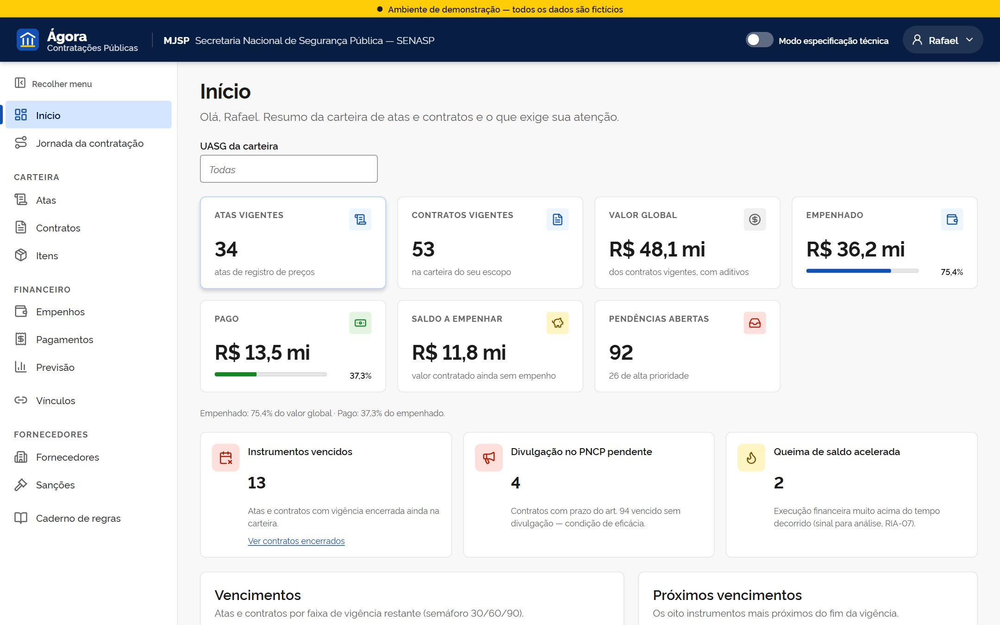

- **Faixa amarela no topo:** aparece só nos ambientes de demonstração e de homologação, para lembrar que os dados não são reais.
- **Cabeçalho:** a marca da Ágora leva ao início. Ao lado ficam o nome do órgão, o botão **Modo especificação técnica** (seção 19) e o menu com o seu nome.
- **Menu lateral:** organizado em grupos (Carteira, Financeiro, Fornecedores e outros). **Recolher menu** deixa só os ícones, para ganhar espaço. Itens que o seu perfil não pode usar não aparecem.
- **Área principal:** no alto fica o caminho da página (por exemplo, "Início › Contratos"), que serve para voltar. Abaixo dele vêm o título e os botões de ação da página.

### Tabelas, buscas e filtros

As listas da Ágora funcionam todas do mesmo jeito:

- **Buscar** e os filtros ficam acima da tabela. O número de resultados é atualizado a cada filtro.
- Clique no título de uma coluna para ordenar por ela.
- **Colunas** escolhe quais colunas aparecem. **Densidade** deixa a tabela mais compacta ou mais espaçada. **Itens por página** e os botões de página ficam no rodapé da tabela.
- Os filtros ficam guardados no endereço da página. Para mostrar a mesma lista a um colega, basta enviar o link.

### Avisos e erros

- Depois de uma ação, um aviso confirma o que foi feito. Algumas ações oferecem **Desfazer** no próprio aviso.
- Quando algo dá errado, a mensagem explica o problema e mostra um **Código para o suporte**. Envie esse código ao suporte do seu órgão: ele identifica exatamente o que aconteceu.

### No celular

No celular, o menu lateral vira o botão **Menu**, e cada linha das tabelas vira um cartão com as informações principais.

 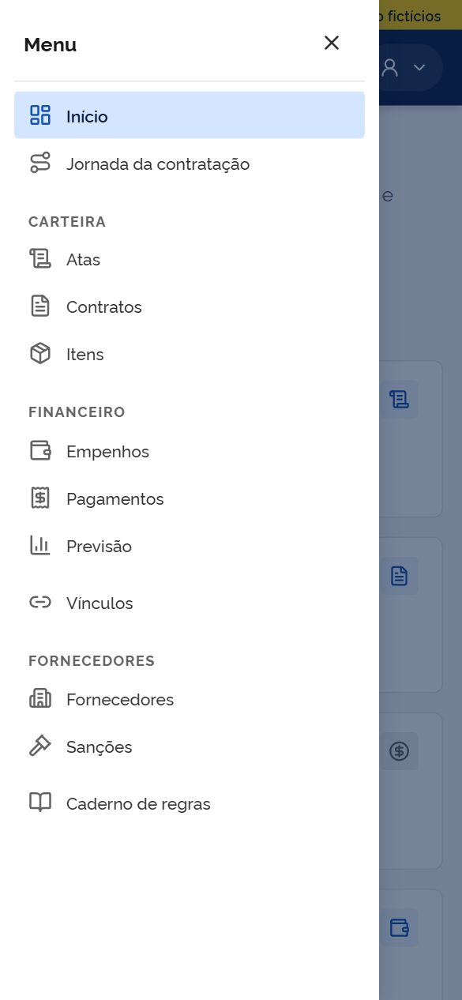

### Acessibilidade

A Ágora segue o Padrão Digital de Governo e pode ser usada só pelo teclado: **Tab** avança, **Shift+Tab** volta e **Esc** fecha janelas. O primeiro item da página, **Ir para o conteúdo principal**, pula direto para o conteúdo. A tela funciona com zoom de até 200% e com leitores de tela.

## 3. O que cada perfil pode fazer

O que você vê e faz depende de dois controles, ambos verificados pelo servidor a cada ação:

- os seus **perfis**;
- o seu **escopo de UASGs**, isto é, as unidades cujos dados você pode ver.

| Perfil | Principais tarefas |
|---|---|
| Gestor de contratos | Acompanha atas e contratos, resolve pendências, conclui tarefas do plano de gestão, vincula instrumentos e instaura processos sancionatórios. Designa a fiscalização, exige garantias e aprova o plano de contratações anual. Consulta a jornada da contratação. |
| Fiscal de contrato | Cumpre as tarefas do plano de gestão, resolve pendências, registra ocorrências, entregas e termos de recebimento, mede o IMR e **atesta notas fiscais** após conferência. |
| Financeiro | Acompanha empenhos, pagamentos e a previsão, vincula empenhos, registra garantias e compras com cartão de pagamento e executa as sincronizações com os sistemas do governo. |
| Planejamento | Conduz a fase preparatória da jornada: DFD, ETP, matriz de riscos, dotação orçamentária e pesquisa de preços. Registra o plano de contratações anual e as intenções de registro de preços. |
| Agente de contratação | Conduz a seleção do fornecedor, a sala de disputa, os atos da seleção e **publica** editais e avisos. |
| Assessoria jurídica | Faz o controle prévio de legalidade (art. 53), analisa pareceres em alterações contratuais e registra manifestações. |
| Controle interno | Acompanha a 2ª linha de defesa: medidas de controle externo, matriz de achados preventivos, auditor contínuo e revisões trimestrais de riscos. |
| Auditor | Consulta tudo, verifica a integridade da trilha de auditoria e acompanha os acessos a dados pessoais. Pode revelar dados pessoais, com finalidade registrada. |
| Cidadão | Acessa a gestão compartilhada com a sociedade pelo Login Único gov.br para enviar manifestações sobre contratos em execução. |
| Consulta | Somente leitura dos instrumentos e da execução financeira das UASGs autorizadas. |
| Administrador | Cuida de usuários, perfis, fila de integrações, ajustes e operação sustentável. Tem todas as permissões. |

A tabela completa de permissões está em **Administração › Perfis** (para o administrador). A tela **Perfis de acesso** é só de consulta. Se você precisa de uma função que não aparece no seu menu, peça ao administrador para ajustar os seus perfis.

## 4. Início, pendências e linha do tempo

A tela **Início** reúne o que pede atenção na carteira:

- **Indicadores da carteira**, com o seletor **UASG da carteira**;
- os alertas **Instrumentos vencidos**, **Divulgação no PNCP pendente** (prazo do art. 94 vencido) e **Queima de saldo acelerada**;
- **Vencimentos** em 30, 60, 90 e 120 dias e **Próximos vencimentos**;
- a **Linha do tempo de vencimentos**;
- a **Fila de pendências**.

Cada conjunto de dados informa a fonte e o horário da última atualização. Enquanto carrega, a tela mostra blocos cinzas no formato do conteúdo; números zerados durante o carregamento não acontecem.

### Linha do tempo dos vencimentos e semáforo de 120 dias

O painel inicial mostra os **Vencimentos** e a **Linha do tempo de vencimentos** de contratos e atas de registro de preços nos próximos 120 dias (RN-31). As faixas são:

- **Planejamento (91 a 120 dias):** alerta para iniciar estudos de prorrogação ou planejamento de nova contratação.
- **Alerta (61 a 90 dias):** providências de prorrogação ou instrução licitatória em andamento.
- **Atenção (31 a 60 dias):** prazos críticos para assinaturas e publicação de aditivos.
- **Crítico (até 30 dias):** aviso prioritário e obrigatório para gestores e fiscais.
- **Vencido:** vigência encerrada.

Instrumentos com mais de 120 dias de vigência restante não entram nas faixas.

A varredura diária do servidor consolida os instrumentos em cada faixa e gera pendências e notificações automáticas dirigidas aos responsáveis.

### Resolver uma pendência

Perfis: gestor de contratos, fiscal de contrato e administrador.

1. Em **Fila de pendências**, use **Buscar** e os filtros **Tipo**, **Prioridade** e **Situação**, ou marque **Somente as minhas**. A UASG é a escolhida em **UASG da carteira**, no alto da tela.
2. Na linha da pendência, clique em **Resolver**.
3. Em **Observação da resolução**, explique o que foi feito (até 500 caracteres), por exemplo: "Termo aditivo de prorrogação assinado em 05/11". O campo é obrigatório.
4. Clique em **Resolver pendência**. Se você se enganou, clique em **Desfazer** no aviso que aparece.

A resolução fica no histórico do contrato ou da ata e na trilha de auditoria.

## 5. Contratos

Em **Contratos** (menu **Carteira**), use **Buscar** e filtre por **Situação** e **UASG**, ou marque **Sob minha gestão** e **Sem ata de origem**. Clique no número do contrato para abri-lo.

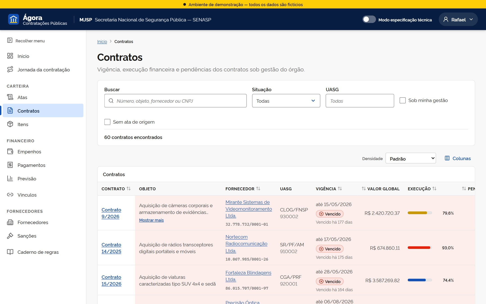

A página do contrato mostra:

- **Resumo do contrato** e **Linha do tempo**, da assinatura ao fim da vigência;
- **Divulgação no PNCP:** situação e prazo do art. 94;
- **Queima de saldo:** ritmo de execução e projeção de quando o saldo acaba;
- **Garantia contratual.**

Os botões ao lado do número copiam o número do processo e o identificador do PNCP. **Abrir no PNCP** abre o registro oficial em outra aba. O botão **Notificar** no topo abre o disparo direto de avisos.

As abas trazem a gestão completa:

- **Plano de gestão:** tarefas de fiscalização e gestão, geradas pelos modelos de gestão. Gestor e fiscal usam **Concluir** e **Reabrir** na linha da tarefa e confirmam.
- **Itens**, **Empenhos** e **Pagamentos:** a execução física e financeira do contrato. Para atestar uma nota, use a tela **Pagamentos** do menu **Financeiro** (seção 7).
- **Alterações:** limites do art. 125, prorrogação, reajuste e o histórico de aditivos, apostilas, reequilíbrios e extinção (RF-27).
- **Histórico:** tudo o que aconteceu com o contrato, inclusive as pendências resolvidas.
- **Matriz de riscos:** acompanhamento dos riscos e registro das revisões trimestrais obrigatórias (RN-29).
- **Fiscalização**, **Recebimentos** e **Garantias:** os atos da execução, no fim desta seção.
- **IMR e medições:** indicadores de nível de serviço, medições mensais e glosas (RF-29).
- **Avaliação de desempenho:** emissão da avaliação, manifestação do contratado e análise (RN-37, RF-30).
- **Ocorrências da execução:** fatos da execução que alimentam as lições aprendidas e o desempenho (RIA-12).

### Aba Alterações (RF-27)

Perfis: gestor de contratos e administrador propõem e registram; a assessoria jurídica emite o parecer prévio; o gestor, como autoridade competente designada no processo, assina.

A aba **Alterações** reúne os limites do art. 125 (**Acréscimos acumulados** e **Supressões acumuladas**), a seção **Prorrogação e reajuste** e o **Histórico de alterações**. Os atos são:

1. **Termo aditivo (art. 125, RN-32):** clique em **Propor termo aditivo**.
   - Escolha o **Tipo de alteração**: acréscimo quantitativo, supressão quantitativa, alteração qualitativa, prorrogação da vigência ou reequilíbrio econômico-financeiro. Informe o valor e a **Justificativa**.
   - A Ágora confere os limites legais acumulados (até 25% para compras e serviços ou 50% para reforma de edifícios e equipamentos) e recusa o termo que passa da margem.
   - A assessoria jurídica abre o termo e clica em **Registrar parecer jurídico**. A autoridade confirma a assinatura. Antes disso, o servidor confere a regularidade do contratado e consulta o CEIS e o CNEP (RN-09).
   - O termo gera PDF (**Termo em PDF**) e vai para a fila de divulgação no PNCP. Se falhar, use **Reenviar ao PNCP**.
2. **Prorrogação de vigência (arts. 105 a 114, RN-33):** use **Registrar prorrogação** na seção **Prorrogação da vigência (RN-09 e RN-33)** e, no fim, **Verificar e prorrogar**. Também sai de **Propor termo aditivo**, com o tipo prorrogação da vigência.
   - A Ágora respeita a vigência máxima da natureza do objeto (por exemplo, até 10 anos nos serviços e fornecimentos contínuos e até 15 anos nos sistemas estruturantes de TI).
   - Marque as condições exigidas, como o crédito orçamentário do exercício e a previsão no edital. A tela mostra a regularidade do contratado.
3. **Reajuste e repactuação por apostila:**
   - **Registrar reajuste:** só habilitado depois de 12 meses da data-base do orçamento estimado. Informe a variação do índice e a fonte. Confirme em **Apostilar reajuste**.
   - **Registrar repactuação:** para serviços com dedicação exclusiva de mão de obra. Informe os componentes de custo (**Acrescentar componente**) e confirme em **Apostilar repactuação**.
   - Reajuste e repactuação ficam com o gestor, que decide.
4. **Reequilíbrio econômico-financeiro (art. 124, II, "d"):** também sai de **Propor termo aditivo**, com o **Enquadramento do evento**, o **Risco da matriz de riscos** e a **Demonstração do desequilíbrio**.
5. **Extinção do contrato (arts. 137 a 139):** clique em **Abrir extinção** e preencha a **Forma da extinção** e o **Motivo (art. 137)**. Na extinção unilateral, a Ágora abre o prazo de defesa do contratado (**Registrar defesa**), e a autoridade decide em **Decidir a extinção** ou usa **Indeferir**.

Abaixo do histórico fica o **Simulador de aditivo (art. 125)**: informe o tipo e o valor e clique em **Simular** para ver o percentual acumulado. Nada é gravado.

### Aba IMR e medições (RF-29)

Perfis: o gestor de contratos configura; o gestor e o fiscal de contrato medem.

1. **Configuração de indicadores:** o gestor clica em **Incluir indicador** e informa código, nome, forma de cálculo, meta, **Periodicidade**, **Fonte da medição**, itens alcançados e as faixas de glosa (**Incluir faixa**). **Alterar** e **Encerrar** ficam em cada indicador.
2. **Medição de cada competência:** o gestor ou o fiscal clica em **Registrar medição**, escolhe a **Medição pendente**, informa o resultado e a **Evidência da medição**. A Ágora calcula a glosa, com memória de cálculo determinística.
3. **Encaminhamento:** a faixa pode prever a avaliação de processo sancionatório. Nesse caso, a medição abre uma pendência para o gestor. A decisão é humana.

### Abas Avaliação de desempenho e Ocorrências da execução (RN-37, RF-30)

Perfis: gestor de contratos e fiscal de contrato emitem a avaliação. Só o gestor e o fiscal designados no contrato podem avaliar. Administrador também.

1. **Ocorrências da execução:** na aba própria, **Registrar ocorrência** com o **Tipo**, a **Categoria da lição**, a **Data** e a **Descrição do fato**. Quando a ocorrência é resolvida, marque **No prazo** ou **Fora do prazo** na coluna **Solução**.
2. **Emissão da avaliação:** na aba **Avaliação de desempenho**, clique em **Emitir avaliação de desempenho**, informe o período e a **Avaliação motivada**. A nota vem dos indicadores apurados pela Ágora, sem atribuição subjetiva.
3. **Manifestação do contratado:** o contratado tem 5 dias úteis. Use **Registrar manifestação do contratado** e depois **Analisar manifestação**. A avaliação definitiva passa a constar do registro cadastral, com PDF e protocolo.

### Revisão trimestral da matriz de riscos (RN-29)

Perfis: gestor de contratos, fiscal de contrato, controle interno e administrador.

A matriz de riscos de cada contrato deve ser revisada a cada 3 meses:
1. Abra a aba **Matriz de riscos** no contrato.
2. A tela indica se a revisão está vencida ou a vencer, com alerta antecipado de 15 dias.
3. Clique em **Registrar revisão trimestral**. Atualize a **Probabilidade**, o **Impacto**, a **Alocação** e o **Tratamento** de cada risco (use **Incluir risco** para acrescentar) e escreva a **Observação da revisão**. Confirme em **Registrar revisão**. A revisão fica na trilha de auditoria.

### Notificar contratada ou fiscais (RF-26)

Perfis: gestor de contratos, fiscal de contrato e administrador.

No topo da página do contrato (e da ata), clique em **Notificar**:
1. Escolha o **Tipo de aviso**: vencimento, reajuste, garantia (só se o contrato tem garantia), pendência ou ocorrência.
2. Marque os destinatários (fiscal, gestor e contratada) e os canais: **E-mail institucional**, **Registro no processo SEI** ou **gov.br**.
3. Nas pendências e ocorrências, informe o motivo ou o relato e o prazo. Se quiser, escreva uma **Mensagem complementar**.
4. Clique em **Enviar aviso**. A mensagem vai pela fila de envios e fica na trilha de auditoria.

### Execução do contrato: fiscalização, recebimentos e garantias (RN-34, RN-35, RF-28)

As abas **Fiscalização**, **Recebimentos** e **Garantias** do contrato registram os atos da execução. A tela **Prazos de pagamento**, no menu **Financeiro**, acompanha o prazo de cada parcela (seção 7).

Quem faz o quê:

- **gestor de contratos:** designa a equipe, define os prazos do contrato, registra as ordens de serviço, exige garantias, registra o desconto de multa e a execução da garantia (como autoridade designada) e a alteração justificada da ordem cronológica;
- **fiscal de contrato:** registra ocorrências, entregas, o recebimento provisório e a verificação das reservas de cargos;
- **gestor ou membro da comissão de recebimento:** lavra o recebimento definitivo;
- **financeiro:** exige garantias, registra a apresentação, a renovação e a liberação das garantias e acompanha os prazos de pagamento;
- **auditor, controle interno e consulta:** consultam.

Para registrar ocorrências, entregas e termos, além do perfil é preciso estar **designado no contrato**.

**Fiscalização**

1. Na aba **Fiscalização**, seção **Gestão e fiscalização**, clique em **Designar**.
2. Escolha o **Papel** (gestor do contrato, fiscal técnico, fiscal administrativo, fiscal requisitante ou comissão de recebimento definitivo), o **Servidor**, o **Ato de designação** e o **Início**. Marque **Substituto** se a pessoa só atua nas ausências do titular.
3. Clique em **Registrar designação**. Uma designação nova substitui o titular anterior do mesmo papel. Para encerrar uma designação, use **Encerrar**.

Gestor e fiscal técnico não podem ser a mesma pessoa.

Para anotar um fato da execução, use **Registrar ocorrência** no **Livro de ocorrências**. Escolha o **Tipo**, informe a **Data do fato**, o **Relato**, a **Providência determinada** e, se for o caso, o **Prazo para regularização**. Com prazo, a contratada é notificada por e-mail e no processo SEI. Quando a falha for corrigida, clique em **Regularizar** na linha da ocorrência.

**Recebimentos**

1. Em **Prazos do contrato**, o gestor clica em **Alterar prazos** (ou **Definir prazos**, se ainda não há). Os prazos de recebimento, liquidação e pagamento, o índice de atualização e as vagas reservadas do edital ficam aí.
2. Quando a contratada entregar, o fiscal designado clica em **Registrar entrega**, descreve a entrega, escolhe a **Nota fiscal** (se já houver) e informa o valor e a data.
3. Na linha da entrega, o fiscal clica em **Termo provisório**, escolhe o **Resultado** e clica em **Registrar termo**.
4. Depois, o gestor ou um membro da comissão clica em **Termo definitivo**. Quem lavrou o provisório não pode lavrar o definitivo.

Com **ressalva** ou **rejeição**, descreva o que está em desacordo: a contratada recebe o prazo para corrigir ou substituir, e a ocorrência entra no livro. O termo definitivo aceito **atesta a nota fiscal** ligada, depois da nova consulta de regularidade do contratado, e o prazo de pagamento começa. Cada termo tem o seu PDF na coluna **Termos**.

Na seção **Ordens de serviço**, o gestor clica em **Registrar ordem de serviço** e informa o número, a data e o que a ordem autoriza. Se o contrato prevê um período antes da ordem de serviço, a ordem expedida antes do fim desse período fica marcada.

**Reservas legais de cargos.** Todo mês, na aba **Fiscalização**, seção **Reservas legais de cargos**, o fiscal clica em **Registrar verificação** e informa a competência, os empregados alocados no contrato, as vagas ocupadas por mulheres vítimas de violência doméstica e por pessoas presas ou egressas, e se a empresa comprovou as cotas de pessoas com deficiência e de aprendizes. Os percentuais exigidos vêm do edital e ficam nos prazos do contrato. A Ágora guarda só as quantidades, nunca nomes. Com pendência, a verificação entra no livro de ocorrências.

**Garantias**

1. Na aba **Garantias**, clique em **Exigir garantia**. Informe a **Finalidade**, o percentual (até 5%; acima disso, justifique) e o **Prazo de apresentação**. A contratada é notificada.
2. Quando a contratada apresentar, clique em **Registrar apresentação** e informe a modalidade, o valor, a validade e o documento.
3. Antes do vencimento, use **Renovar**. Ao final da execução, use **Liberar**: a caução em dinheiro é devolvida com atualização. A autoridade pode usar **Executar** a garantia, com decisão registrada.

A Ágora avisa o gestor e o fiscal 30 dias antes da validade, pela central de notificações. Para descontar uma multa aplicada, em **Multas aplicadas** clique em **Descontar**: a tela mostra quanto sai dos pagamentos devidos, quanto sai da garantia e quanto fica para cobrança. Informe a autoridade, o ato e a justificativa e clique em **Registrar desconto**. A contratada é notificada para recompor a garantia.

## 6. Atas de registro de preços e itens

Em **Atas**, a aba **Registradas** lista as atas vigentes e encerradas, e a aba **A montar** lista as que ainda estão em preparação. Use **Buscar** e os filtros **Situação**, **Criticidade**, **UASG** e **Sob minha gestão**. A coluna **Consumo** mostra quanto da ata já foi contratado.

A página da ata mostra os dados, a linha do tempo e as abas **Plano de gestão**, **Itens**, **Contratos vinculados**, **Reajuste** e **Histórico**. O botão **Notificar** fica no topo.

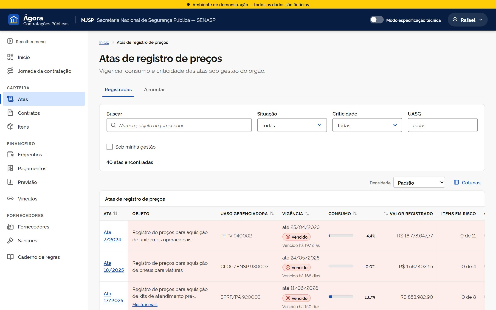

Em **Itens** fica a carteira de itens de todas as atas e contratos, com os filtros **UASG**, **Alocação em contrato** e **Empenho**. O botão **Exportar CSV** baixa os itens filtrados para abrir numa planilha.

## 7. Financeiro

### Empenhos

Em **Empenhos**, filtre por **Saldo**, **Restos a pagar**, **Ano de emissão** e **UASG**. A tabela mostra o valor empenhado, o valor pago e o saldo de cada nota de empenho.

### Pagamentos e atesto de notas fiscais

**Pagamentos** segue a ordem cronológica de pagamentos por fonte de recurso (art. 141). Use **Buscar** e o filtro **Situação**. A coluna **Ordem** mostra a posição de cada parcela. A coluna **Ações** traz **Conferir nota**, **Atestar** e **Verificar regularidade**, conforme a situação da parcela e o seu perfil.

Para atestar uma nota fiscal (perfis fiscal de contrato e administrador):

1. Se o contrato tiver IMR configurado, o atesto exige a conferência da nota. Na linha da nota, clique em **Conferir nota** e registre a conferência (veja adiante).
2. Em **Pagamentos**, na linha da nota, clique em **Atestar**.
3. Confira nota fiscal, contrato, fornecedor, competência, vencimento e valor.
4. A janela mostra o resumo da conferência e a prévia da regularidade no CEIS/CNEP e nas certidões.
5. Clique em **Atestar pagamento**.

Se a nota está ligada a uma entrega do contrato (aba **Recebimentos**), ela só é atestada pelo termo de recebimento definitivo.

> **Atenção:** ao atestar, você confirma que o objeto foi entregue ou executado conforme o contrato (art. 140). O atesto fica na trilha de auditoria e **não pode ser desfeito por esta tela**.

### Conferência da nota fiscal com IMR antes do atesto (RN-36)

Perfis: gestor de contratos, fiscal de contrato, financeiro e administrador.

1. Em **Pagamentos**, clique em **Conferir nota**. Em **Registrar a nota fiscal**, preencha o **Número da nota fiscal**, a **Data de emissão**, o **Valor total da nota** e, em cada item, a quantidade recebida, a quantidade cobrada e o preço unitário cobrado. Clique em **Registrar a conferência**.
2. A Ágora confronta a nota com as medições do IMR da competência e mostra **Valor da nota × valor devido**:
   - Valor devido = (preço unitário contratado × quantidade recebida) − glosa do IMR.
3. Se houver divergência entre o valor cobrado e o valor devido, ou medição pendente, o atesto fica bloqueado.
4. Para liberar o atesto com divergência, escreva a **Justificativa da divergência** e clique em **Registrar justificativa**.

### Recheque de regularidade no atesto e no pagamento (RN-23)

Perfis: fiscal de contrato (no atesto) e gestor de contratos, fiscal de contrato, financeiro, agente de contratação e administrador (consulta).

1. Antes do atesto, a janela **Atestar pagamento** mostra a situação do fornecedor no CEIS e no CNEP e a validade das certidões fiscal federal, do FGTS e trabalhista.
2. Antes do pagamento, nas parcelas que já passaram do atesto, clique em **Verificar regularidade** e depois em **Consultar e verificar**.
3. Se houver irregularidade, o atesto segue com registro formal de ressalva e abre uma pendência para notificar a empresa.
4. A irregularidade superveniente não impede o pagamento do que já foi prestado e atestado. Cabe à autoridade instaurar processo sancionatório se a mora persistir.

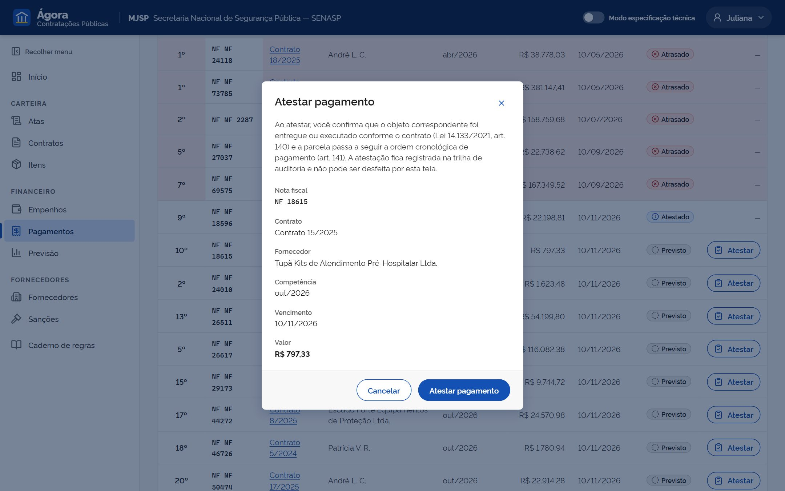

### Previsão de pagamentos

Escolha o **Exercício**. O gráfico compara o previsto e o realizado de cada mês, e a tabela abaixo dele detalha o previsto e o realizado de cada contrato no ano.

### Prazos de pagamento (RN-34)

Em **Prazos de pagamento**, cada parcela mostra o **Marco** que inicia o prazo, a data **Pagar até** e a **Situação do prazo**. Use **Buscar** e o filtro **Situação do prazo**. Nas parcelas vencidas, a coluna **Atualização estimada** traz o cálculo da correção e dos juros, que só são devidos se o atraso for da Administração. Os indicadores do alto contam as parcelas **Vencidos**, **Vencem hoje**, **No prazo** e **Aguardando o marco**.

Para pagar uma nota fora da ordem cronológica (perfis gestor de contratos e administrador):

1. Na linha da parcela, clique em **Alterar a ordem**.
2. Escolha a **Hipótese do art. 141, § 1º** e registre a justificativa, a autoridade competente, o ato e a data da decisão, antes do pagamento. Clique em **Registrar alteração**.
3. Depois, em **Alterações justificadas da ordem cronológica**, registre a comunicação ao controle interno e ao tribunal de contas, com a data e o protocolo (**Registrar comunicação**).

O controle interno vê a alteração no painel da 2ª linha de defesa, entre as exceções justificadas.

## 8. Vínculos

Perfis que podem vincular: gestor de contratos, financeiro e administrador.

**Vínculos** junta o que ficou solto na carteira, em três abas:

- **Contratos sem ata**
- **Empenhos sem contrato**
- **Empenhos sem item**

O número ao lado de cada aba mostra quantos casos há. A Ágora sugere o vínculo mais provável e mostra o grau de **Confiança** da sugestão.

1. Confira a sugestão na linha.
2. Clique em **Vincular à ata sugerida** (contratos), **Vincular ao contrato sugerido** (empenhos sem contrato) ou **Vincular a item** (empenhos sem item) e confirme em **Vincular**. O consumo da ata e o saldo contratável são recalculados.
3. Se precisar, use **Desfazer** no aviso que aparece em seguida.

## 9. Jornada da contratação

A jornada conduz cada contratação pelas 7 etapas da Lei 14.133/2021:

1. Demanda e PCA
2. Instrução no SEI e equipe
3. ETP, riscos e preços
4. TR, edital e minuta
5. Controle jurídico e publicação
6. Seleção do fornecedor
7. Contrato e gestão

Quem trabalha em cada etapa:

- **Planejamento e agente de contratação:** editam o processo e avançam de etapa.
- **Assessoria jurídica:** registra o parecer, na etapa 5.
- **Agente de contratação:** publica o edital e conduz a sala de disputa.
- **Gestor de contratos:** acompanha, sem editar. Quando é designado **autoridade competente** do processo, decide recursos, adjudica, homologa e autoriza a contratação direta, na etapa 6.
- **Auditor, controle interno e consulta:** acompanham, sem editar.

Na página do processo, os botões do alto são **Exportar dossiê**, **Documentos e habilitação**, **Conferir documentos**, **Sigilo** e **Avançar para a etapa N**. Cada perfil vê só os que pode usar.

### Criar um processo

1. Em **Jornada da contratação**, clique em **Novo processo**.
2. Informe o **Objeto** (título do processo) e o **Órgão requisitante**.
3. Clique em **Criar processo**. O processo começa na etapa 1, com número SEI gerado pela Ágora.

### Como ler a página do processo

- **Faixa de etapas:** mostra onde o processo está. Etapas concluídas têm um sinal de confirmação, e etapas com problema têm um alerta.
- **Painel da etapa:** os formulários e documentos daquela fase.
- **Árvore do processo SEI:** os documentos numerados e as assinaturas.
- **Bloqueios:** regras da lei que **impedem** o avanço até serem resolvidas.
- **Sinais:** pontos de **atenção** que não impedem o avanço, como "demanda fora do PCA". Um sinal pede análise humana e nunca é uma acusação.

### Avançar de etapa

1. Clique em **Avançar para a etapa N** e confirme em **Avançar etapa**.
2. O servidor confere todas as regras da etapa. Se alguma não estiver atendida, o processo **permanece na etapa** e o aviso lista cada regra, com a explicação e o fundamento legal.
3. Resolva os bloqueios no painel da etapa e tente de novo.

### O que fazer em cada etapa

**Etapa 1 — Demanda e PCA.** Preencha o DFD:

- **Descrição da necessidade**, **Justificativa da contratação** e **Natureza do objeto**;
- os **Itens da demanda**, usando **Adicionar item**;
- a marcação **Demanda prevista no Plano de Contratações Anual (PCA)**;
- **Itens identificados no catálogo padronizado (CATMAT/CATSER)**, com a **Justificativa da não utilização do catálogo padronizado** quando a caixa fica desmarcada;
- **Lições aprendidas de contratações anteriores (RIA-12):** a Ágora pesquisa contratos anteriores do órgão com objetos semelhantes e apresenta ocorrências, atrasos e boas práticas como sugestões de cláusulas. O planejador avalia cada uma e usa **Considerar no DFD** ou **Não considerar**.

Se algum item não estiver no catálogo padronizado (CATMAT/CATSER), a justificativa é obrigatória (art. 19, § 2º). A trava de artigo de luxo (RN-01, art. 20) identifica automaticamente bens com características suntuosas e bloqueia o avanço da etapa e a geração de minutas até que o responsável registre justificativa formal demonstrando a qualidade comum do objeto. A Ágora também sinaliza quando a soma das dispensas no exercício se aproxima do limite legal (art. 75, § 1º). Clique em **Salvar DFD**.

Abaixo do DFD ficam as seções **Plano de contratações anual (PCA)**, **Código do catálogo** e **Registro de preços compartilhado**, e, depois delas, o quadro **Rota de contratação**. Salve ou descarte as alterações do DFD antes de usar essas seções.

**Plano de contratações anual (PCA) no DFD (RF-31).** Quem edita a jornada (planejamento e agente de contratação) faz a conferência do DFD com o PCA publicado (art. 18, § 1º, II):

1. Quando a UASG tem PCA publicado para o exercício, escolha **Item do PCA publicado** e o **Item do PCA**, ou escolha **Não consta do PCA** e escreva a justificativa da contratação não prevista (mínimo de 30 caracteres).
2. Clique em **Registrar vínculo com o PCA**. Sem esse passo, o processo não avança da etapa 1.
3. **Consultar o PCA no PNCP** atualiza os itens publicados da UASG.

A marcação "Demanda prevista no PCA" acompanha o vínculo. Se o PCA ainda não foi publicado, a Ágora só mostra um sinal informativo.

**Código do catálogo (RIA-13).** Em cada item salvo, clique em **Sugerir código para o item N**. A Ágora mostra os itens do catálogo mais parecidos, com a semelhança em porcentagem e as premissas. Confira a descrição e clique em **Usar o código … no item N**. A escolha é sua e fica na trilha. A sugestão é calculada por semelhança de texto e requer revisão humana. Se um item sem código está com o catálogo marcado, aparece um sinal para usar a sugestão ou justificar.

**Registro de preços compartilhado (RIA-01).** Quando outras unidades preveem o mesmo item, a seção mostra as unidades e as quantidades. Quem tem o perfil de planejamento ou de agente de contratação pode abrir **Propor intenção de registro de preços para o código N**, que leva ao formulário da IRP já preenchido (seção 10). A decisão é sua: a Ágora não calcula economia.

**Rota de contratação (RF-34).** Em **Rota de contratação**, escolha em **Como o órgão vai contratar**:

- **Licitação**: pregão ou concorrência. É a rota padrão, e nada muda nos processos que não escolheram outra;
- **Dispensa de licitação**;
- **Inexigibilidade**;
- **Adesão a ata de registro de preços**;
- **Comércio eletrônico (Sicx)**.

Na dispensa, escolha a **Hipótese de dispensa**. A hipótese por valor serve para compras pequenas: em 2026, até R$ 65.492,11 em compras e serviços e até R$ 130.984,20 em obras e serviços de engenharia. Informe o **Ramo de atividade do objeto** (por exemplo, "material de expediente"). Em outra hipótese do art. 75, informe o **Inciso do art. 75**. Na inexigibilidade, escolha a **Hipótese de inexigibilidade (art. 74)**. Escreva a **Justificativa da escolha da rota** e clique em **Salvar rota**.

A Ágora mostra o limite vigente, a soma do mesmo ramo no exercício (dispensas e compras com cartão de pagamento) e os **Documentos e travas da rota (art. 72)**.

- Se a soma passar do limite, aparece o sinal de fracionamento. Registre a **Análise do agente sobre o indício de fracionamento** para seguir, ou licite o objeto.
- A rota adapta as etapas seguintes: na dispensa e na inexigibilidade não há edital nem disputa. Na dispensa por valor, o ETP e a matriz de riscos são facultativos. No Sicx, não há termo de referência, edital nem contrato: a compra vale como contratação.

**Etapa 2 — Instrução no SEI e equipe.**

1. Em **Designação da equipe**, use **Adicionar designação** para indicar requisitante, equipe de planejamento, agente de contratação, comissão de contratação e autoridade competente. Clique em **Salvar designações**.
2. **Segregação de funções (art. 7º, § 1º):** se a mesma pessoa for designada para funções inconciliáveis (como agente de contratação e fiscal), o sistema barra a confirmação.
3. **Declaração de inexistência de impedimentos (RN-28):** cada agente designado assina formalmente declaração de que não possui vínculo de parentesco até 3º grau, relação comercial ou conflito de interesses com licitantes habituais, além de comprovar vínculo permanente e capacitação para funções essenciais. Cada servidor assina a sua em **Minha declaração de impedimentos**, no menu lateral. Agentes sem declaração válida não podem atuar no processo.
4. **Integração com o SEI (RF-35):** na coluna lateral, junto da **Árvore do processo SEI**, a seção **Integração com o SEI** tem o botão **Enviar ao SEI**. Os documentos aprovados na seção **Instrução no SEI** da etapa entram nessa árvore. O sistema gera o processo no SEI do órgão via web service (SeiWS), insere os documentos aprovados na árvore e cria o bloco de assinaturas. Os servidores assinam no próprio SEI com certificado digital ICP-Brasil. Clique em **Consultar assinaturas** para a Ágora sincronizar a situação.

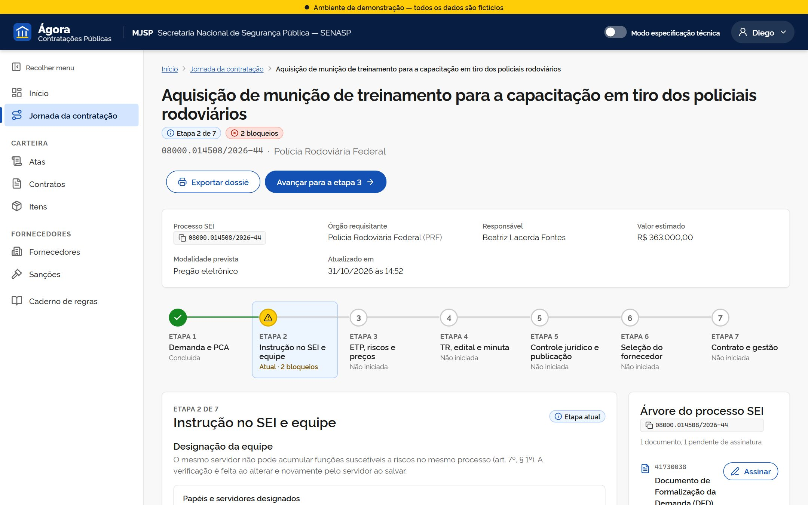

**Etapa 3 — ETP, riscos e preços.**

- **ETP (art. 18):** preencha os 13 incisos do estudo técnico preliminar. Os incisos I, IV, VI, VIII e XIII são de preenchimento obrigatório por lei. Clique em **Salvar ETP**.
- **Sustentabilidade ambiental e logística reversa (RN-21):** em conformidade com a política do órgão (art. 5º e art. 11, IV), o preenchimento dos **Critérios de sustentabilidade ambiental** e da **Logística reversa** é obrigatório no ETP e no TR para avanço e aprovação. Clique em **Salvar critérios**.
- **Lições aprendidas (RIA-12):** consulte as sugestões de mitigação de riscos baseadas em execuções contratuais anteriores. Use **Considerar no ETP** nas que forem pertinentes.
- **Matriz de riscos:** registre os riscos da contratação com **Incluir risco**. O mapa de calor confronta probabilidade × impacto e aponta as ações preventivas e a alocação de responsabilidades.
- **Pesquisa de preços (art. 23):**
  - **Consulta automática de preços (RF-25):** na seção **Consulta automática de preços**, informe o **Termo de busca** ou o **Código CATMAT/CATSER** e clique em **Buscar preços**. O servidor consulta o Painel de Preços, contratações similares do governo federal e notas fiscais eletrônicas. Para serviços de engenharia, use **Importar tabela do Sinapi ou do Sicro**. Cada amostra é enquadrada no inciso do art. 23 e o planejador escolhe quais cotações incluir na cesta.
  - **Projeção cambial e inflacionária (RIA-11):** na seção **Projeção do valor estimado**, informe a **Data prevista da contratação** e a **Parcela do valor sujeita ao câmbio (%)** e clique em **Projetar valor**. O sistema projeta o valor com base no IPCA (IBGE) e na taxa média do dólar (Banco Central). O resultado é um sinal, e a decisão é sua.
  - Registre cotações manuais com **Incluir cotação** ou importe uma planilha completa.
  - A Ágora calcula média, mediana e menor preço, e aponta **Expurgos sugeridos (RIA-03)** pelo método Tukey ou percentual. O botão **Marcar todas as sugestões** permite aceitar os expurgos com uma única justificativa registrada.
  - Marque **Manter o orçamento estimado em sigilo** caso a divulgação prévia possa comprometer a disputa (art. 24), informando o **Motivo do sigilo**, e clique em **Salvar opção de sigilo**.

A dotação orçamentária (RN-39) fica na etapa 4. A seção também aparece na etapa 3, para adiantar o preenchimento.

**Importar a cesta de uma planilha.**

1. Na **Cesta de preços**, clique em **Importar planilha**. Se precisar, use **Baixar modelo de planilha (CSV)**.
2. Escolha o arquivo em **Arquivo da planilha** ou cole as linhas copiadas da planilha em **Conteúdo da planilha**.
   - Colunas: fonte, identificação, valor unitário, data da cotação e justificativa (obrigatória na pesquisa direta com fornecedor).
   - A fonte aceita o código, o nome ou o inciso do art. 23, § 1º (I a V).
3. Em **O que fazer com as cotações atuais**, escolha **Acrescentar às N cotações atuais** ou **Substituir as cotações atuais**.
4. Clique em **Conferir planilha**. O servidor confere cada linha e mostra a **Prévia da importação**, com os erros de cada linha. Nada é gravado nesse passo.
5. Com todas as linhas válidas, clique em **Importar N cotações**. A análise estatística é recalculada e os expurgos sugeridos aparecem para o seu aceite.

**Etapa 4 — TR, edital e minuta.**

1. Em **Parâmetros do edital**, defina o **Critério de julgamento (art. 33)** e o **Regime de execução (art. 46)**. O **Modo de disputa** é escolhido depois, na sala de disputa (etapa 6).
2. **Prova de conceito ou amostra (RN-20):** em **Exigência do licitante provisoriamente vencedor**, escolha **Não exigir**, **Prova de conceito** ou **Amostra**. Defina o **Prazo para a realização** (dias úteis contados da convocação), o **Roteiro de testes e critérios objetivos de aprovação** e a justificativa. A prova acontece em sessão pública gravada.
3. Clique em **Salvar parâmetros**.
4. **Qualificação técnica e financeira (RN-25):** no botão **Documentos e habilitação** do processo, a seção **Exigências de qualificação técnica do edital** (botão **Definir exigências de qualificação técnica**) limita os atestados a parcelas de maior relevância (valor igual ou maior que 4% do total estimado), com quantitativo mínimo não superior a 50% da parcela. O balanço patrimonial restringe-se aos 2 últimos exercícios sociais (ou ao último, para empresas com menos de 2 anos).
5. **Desempenho anterior na pontuação técnica (RN-37):** no julgamento por técnica e preço, marque **Considerar o desempenho anterior na pontuação técnica** e informe a **Parte da nota técnica (%)**, a **Nota para quem não tem histórico (0 a 100)** e o **Regulamento que disciplina o critério**.
6. **Dotação orçamentária e declaração de adequação (RN-39, RF-32):** na seção de dotação, use **Incluir crédito** e informe a **Unidade gestora**, o **Programa de trabalho**, a **Natureza da despesa**, a **Fonte de recursos**, o **Exercício**, o **Valor do crédito** e o **Pré-empenho**. Clique em **Salvar dotação**. Depois, gere a **Declaração de adequação orçamentária** nas peças complementares e a autoridade competente designada a aprova. O processo só avança da etapa 4 para a 5 com a dotação declarada. Mudar a dotação depois exige nova declaração.
7. **Peças complementares da instrução (RF-32):** abaixo do painel, a seção **Peças complementares da instrução** gera a portaria de designação, o despacho de autorização da contratação e a nota técnica de encaminhamento à CONJUR, com quesitos objetivos. A portaria, a declaração orçamentária e o despacho são aprovados pela autoridade competente designada: ela abre a peça em **Visualizar** para revisar e aprovar.
8. **Conferência de citações e conferência cruzada (RNF-08, RIA-14, RIA-15):** clique em **Conferir documentos**, no alto do processo. A tela **Conferência dos documentos** traz a **Conferência cruzada entre os documentos**, que compara DFD, ETP, riscos, preços, TR e edital e aponta divergências em prazos, valores, quantitativos e objeto, e as **Citações legais dos documentos**, que conferem se cada dispositivo citado existe e está em vigor na base da Lei 14.133/2021. A aprovação fica bloqueada até **Registrar revisão das citações** apontadas. As minutas usam os modelos padronizados da AGU.
9. Em cada documento (termo de referência, edital e minuta), clique em **Gerar rascunho** (ou **Gerar nova versão**) e em **Visualizar**. Todo documento gerado requer revisão e **Aprovar documento** por servidor responsável, com registro humano.

O IMR do contrato (indicadores, metas e faixas de glosa) é cadastrado depois, na aba **IMR e medições** do contrato (seção 5).

**Documentos do processo e de habilitação (RF-21, RIA-08)**

Perfis: planejamento e agente de contratação enviam; gestor de contratos, assessoria jurídica e outros perfis com acesso consultam. Abra pelo botão **Documentos e habilitação**, no alto do processo.

- **Armazenamento seguro (RF-21):** o envio de documentos aceita formatos PDF, PNG e JPEG. O servidor valida o tipo real pelo conteúdo (não pela extensão), bloqueia códigos ativos ou executáveis, calcula o hash SHA-256 e armazena os arquivos de forma isolada fora do banco com controle de acesso por UASG. O botão **Baixar** em cada arquivo faz o download.
- **Leitura assistida de atestados por OCR (RIA-08):** na seção **Leitura assistida dos atestados (RIA-08)**, o botão **Ler atestado** (ou **Ler de novo**) aciona o serviço de OCR em contêiner isolado local. Ele localiza os quantitativos executados por item, a unidade e o trecho-fonte (página e linha), confrontando o total somado com os mínimos exigidos pelo edital. A leitura gera um sinal analítico e requer revisão humana; a decisão de habilitação é privativa do agente de contratação.

**Sigilo de segurança pública (RN-40, RF-33, RNF-09)**

Perfis: planejamento, agente de contratação, gestor de contratos (autoridade competente) e administrador classificam. Assessoria jurídica, controle interno e auditor consultam. Abra pelo botão **Sigilo**, no alto do processo.

1. **Classificação formal da informação:** processos e anexos que envolvam segurança pública ou atividades de inteligência podem ser classificados nos graus **Reservada** (até 5 anos), **Secreta** (até 15 anos) ou **Ultrassecreta** (até 25 anos), com a **Hipótese de sigilo** e as razões da classificação na LAI (Lei 12.527/2011) e o **Termo final do sigilo**. O orçamento estimado pode ter sigilo próprio (art. 24).
2. **Credenciamento de servidores:** em **Credenciais de acesso**, **Credenciar acesso ao processo** dá o acesso nominal e o **Grau máximo** a cada servidor.
3. **Cofre cifrado de anexos (RNF-09):** peças confidenciais enviadas como anexo sigiloso são armazenadas em cofre criptografado em repouso com algoritmo AES-256-GCM.
4. **Download com marca de segurança:** em **Documentos e anexos**, o PDF marcado estampa o grau de sigilo, o código de indexação e a identidade de quem baixou. O acesso fica no **Registro de acessos** e na auditoria.

**Etapa 5 — Controle jurídico e publicação.**

1. A assessoria jurídica preenche o checklist do **Parecer jurídico (art. 53)**, avaliando cada aspecto formal da instrução, escolhe a **Conclusão do parecer (art. 53)** e clica em **Salvar parecer**. A conclusão é privativa.
2. **Publicação no PNCP pela fila de integrações (RF-19):** na seção **Publicação do edital**, depois de parecer favorável (ou favorável com ressalvas), o agente de contratação clica em **Publicar** e confirma em **Publicar**. O envio é enfileirado no serviço de mensageria com idempotência. Em **Envios ao PNCP** aparecem o protocolo oficial devolvido e o link público do edital, sem login.
3. **Publicação no Diário Oficial da União (RF-36):** no menu **Publicações**, a tela **Publicações no DOU** lista as matérias. Clique em **Gerar matéria** para formatar o aviso de licitação (ou o extrato de contrato ou de aditivo) no padrão da Seção 3. Copie o texto para o INCom e registre o número do protocolo em **Registrar envio pelo INCom**. Depois use **Conferir no DOU**, **Registrar publicação** e, se houver, **Registrar publicação em jornal** de grande circulação.

**Nas rotas diretas (RN-41, RF-34)**, a etapa 5 não tem edital e traz outros quadros, conforme a rota escolhida na etapa 1:

- **Dispensa eletrônica por valor:** depois do parecer jurídico favorável, quem tem o perfil de agente de contratação clica em **Publicar aviso no PNCP**, em **Aviso de dispensa eletrônica**. A tela mostra até quando o aviso fica aberto e quantos dias úteis faltam: são no mínimo 3 dias úteis. Enquanto o aviso estiver aberto, use **Registrar proposta** para as propostas adicionais recebidas (fornecedor e valor total). Depois do encerramento, novas propostas são recusadas, e a etapa só avança com o aviso encerrado.
- **Inexigibilidade:** preencha a **Comprovação da inexigibilidade** (também na etapa 4). A tela pede o que a hipótese exige: documento de exclusividade sem preferência por marca, elementos da notória especialização, edital de chamamento, avaliação do imóvel ou consagração do artista. Clique em **Salvar comprovação**. A conclusão é do agente e do parecer jurídico.
- **Adesão a ata:** o quadro **Aceite do fornecedor e anuência do gerenciador** tem o botão **Registrar aceite do fornecedor**. A anuência vem do gestor da ata (seção 11).

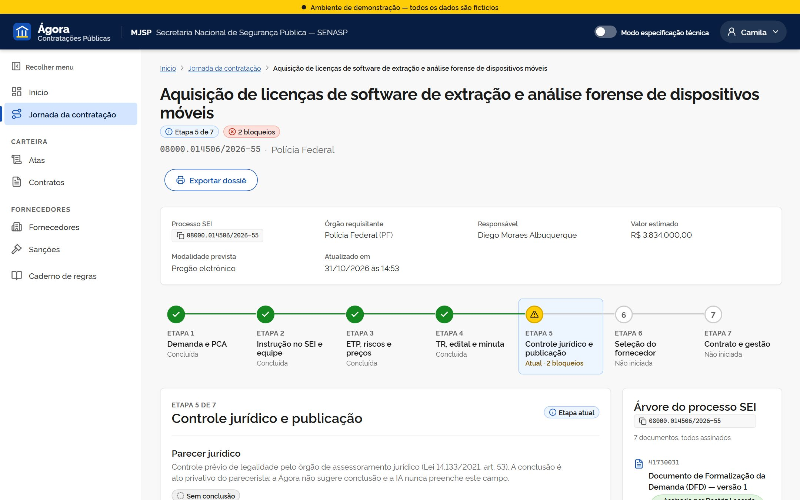

**Etapa 6 — Seleção do fornecedor.**

Perfis: agente de contratação e autoridade competente.

1. **Sala de disputa eletrônica (RF-22, RN-26):** clique em **Abrir sala de disputa** (perfil agente de contratação) e, em **Nova sessão de disputa**, escolha o **Uso da sala**, o **Critério de julgamento** e o **Modo de disputa** (aberto, aberto e fechado ou fechado e aberto). Clique em **Criar sessão** e depois em **Entrar na sala**. Cada comando da sessão fica na trilha de auditoria.
   - **Simulação (treino e PoC-03):** escolha **Simulação (treino e PoC)**. Participantes cadastrados ou licitantes sintéticos enviam ofertas, respeitando intervalos mínimos e prorrogações sucessivas de 2 minutos caso haja lance na reta final. Em **Condução da sessão**, use **Abrir sessão**, **Registrar lance de treino**, **Adiantar 1 minuto** ou **Avançar até o fim da etapa** para acelerar o relógio, e **Encerrar e registrar resultado**.
   - **Acompanhamento da sessão oficial:** escolha **Acompanhar a sessão oficial**. Em compras realizadas pelo Compras.gov.br, informe o identificador da compra, use **Consultar o Compras.gov.br** e **Transcrever lances** da sessão oficial para consolidar a ata.
   - **Sinais de padrão de lances (RIA-09):** o sistema aponta ofertas em intervalos idênticos, reduções fixas sucessivas e alternância de lances entre empresas suspeitas, para análise do pregoeiro.
   - Na própria etapa, **Registrar propostas** guarda as propostas dos licitantes e mostra a classificação e o desempate do art. 60.
2. **Sinais de vínculos societários e impedimentos (RN-27, RIA-10):** a Ágora cruza o quadro societário da Receita Federal com os vínculos informados e declarados, apontando sócios em comum ou empresas coligadas e indícios de sucessão de empresas punidas. A análise por processo está em **Vínculos e impedimentos** (seção 12). O sinal pede análise humana e nunca é uma acusação.
3. **Prova de conceito na sessão pública (RN-20):** caso exigida pelo edital, em **Atos da seleção** o licitante classificado em primeiro lugar é convocado para demonstrar a solução em sessão pública gravada. O agente clica em **Registrar resultado**, com a motivação e o link da gravação. Se for reprovado, o segundo colocado é convocado em sequência. Depois, **Registrar habilitação**.
4. **Fase recursal única (RN-22):** ao fim do julgamento e da habilitação, abre-se o prazo imediato para manifestação da intenção de recurso. Use **Registrar manifestação** para intenções, razões e contrarrazões e **Encerrar registro de intenções** quando acabar o prazo. O prazo legal para razões é de 3 dias úteis, com igual período para contrarrazões. O agente tem 3 dias úteis para a reconsideração e a autoridade tem até 10 dias úteis para a decisão final.
5. **Adjudicação e homologação formal (RF-18):** exauridos os recursos, a autoridade competente designada clica em **Adjudicar o objeto** e em **Homologar a licitação**. Com a homologação, os documentos preparatórios não sigilosos (DFD, ETP, matriz de riscos e pareceres) passam a ser públicos na página de transparência.

**Nas rotas diretas (RN-41, RN-42, RF-34)**, a etapa 6 muda:

- **Dispensa por valor:** encerrado o aviso, clique em **Julgar propostas**. A Ágora classifica pelo menor preço dentro do limite e desclassifica o que passar dele. No empate, vale a proposta recebida primeiro.
- **Dispensa, inexigibilidade e adesão:** a **autoridade competente designada** (perfil gestor de contratos) preenche a **Razão da escolha do contratado**, a **Justificativa de preço**, confirma a habilitação e clica em **Autorizar contratação**.
- **Sicx:** o quadro **Compra pelo Sicx** traz o botão **Comprar na vitrine do Sicx** (seção 11).

**Etapa 7 — Contrato e gestão.**

1. Clique em **Contratar**.
2. **Checklist de regularidade prévia (RN-09, RF-20):** o sistema consulta o CEIS, CNEP, certidões negativas fiscal, trabalhista e do FGTS. Se houver impedimento impeditivo ou certidão vencida, a assinatura é bloqueada até regularização.
3. Em contratos de segurança pública com sigilo reconhecido (RN-40), a publicação na transparência restringe-se a extrato resumido com dados preservados.
4. O contrato formalizado passa a constar da carteira de contratos, com as tarefas do plano de gestão e a pendência de publicação no PNCP em até 20 dias úteis (art. 94). Na dispensa e na inexigibilidade, o prazo é de 10 dias úteis (art. 94, II). Na adesão, a contratação deve ocorrer em até 90 dias da anuência. No Sicx não há contrato: o recebimento e o pagamento ficam na vitrine.

### Exportar o dossiê

1. Clique em **Exportar dossiê**. A Ágora monta, numa só página, os dados do processo, os documentos e as regras aplicadas.
2. Clique em **Imprimir ou salvar em PDF** para gerar o arquivo.
3. Para voltar, clique em **Voltar ao processo**.

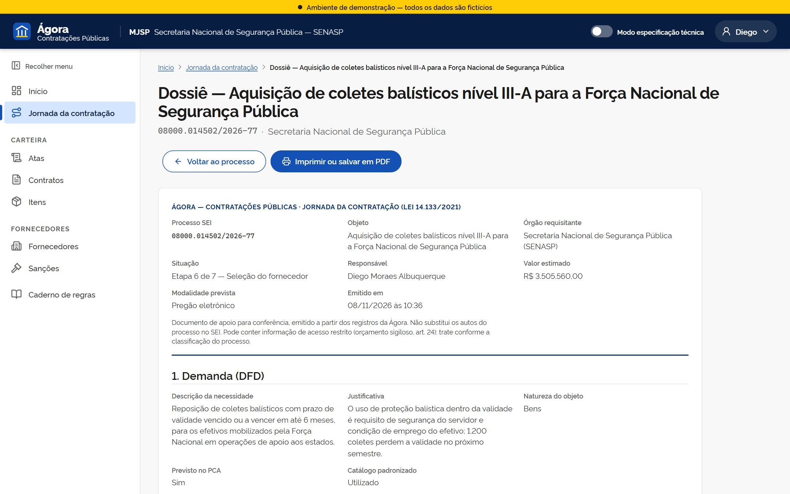

## 10. Planejamento: plano de contratações anual e registro de preços compartilhado

O menu **Planejamento** tem duas telas: **Plano de contratações** e **Intenções de registro de preços**. As seções do DFD que usam o PCA e o catálogo ficam na etapa 1 da jornada (seção 9).

### Plano de contratações anual (RF-31)

Perfis:

- **planejamento:** registra as demandas e consolida o plano;
- **gestor de contratos**, como **autoridade competente:** aprova ou devolve o plano;
- agente de contratação, controle interno e auditor consultam.

Cada usuário vê só os planos das UASGs do seu escopo.

1. Em **Plano de contratações**, use **Abrir** no plano da UASG e do exercício. Para começar um plano novo, use **Abrir plano**.
2. Com o plano **Em elaboração**, use **Registrar demanda** e informe:
   - a **Unidade requisitante**;
   - a **Descrição do objeto** e o **Código do catálogo** (CATMAT ou CATSER), se houver;
   - a **Unidade de fornecimento**, a **Quantidade** e o **Valor unitário estimado**;
   - a **Data desejada**, dentro do exercício;
   - o **Grau de prioridade** e a **Categoria**.

   Para tirar uma demanda, use **Remover**.
3. Quando as demandas estiverem completas, use **Consolidar demandas** e confirme. As demandas de mesmo código, unidade de fornecimento e categoria viram um só item, com as quantidades somadas, a data mais cedo e a prioridade mais alta.
4. A autoridade abre o plano consolidado e:
   - usa **Aprovar e publicar no PNCP** para aprovar. Quem consolidou não pode aprovar;
   - ou usa **Devolver para ajustes** e explica em **Ajustes pedidos** o que deve mudar.
5. Aprovado, o plano é enviado ao PNCP pela fila de integrações. Se o PNCP recusar, o motivo aparece e o botão **Publicar no PNCP** reenvia.

No ambiente de demonstração, a publicação é simulada e a tela avisa.

### Intenções de registro de preços (RN-38)

Perfis:

- **planejamento** e **agente de contratação:** abrem e consolidam as intenções;
- **planejamento** e **gestor de contratos:** registram a adesão das suas unidades;
- todos com acesso ao planejamento consultam.

1. Use **Abrir intenção de registro de preços** e informe a **UASG gerenciadora**, o **Objeto**, o **Código do catálogo**, a **Unidade de fornecimento**, a **Quantidade do gerenciador** e as datas de **Abertura** e **Encerramento**. Clique em **Abrir intenção**.

   A intenção fica aberta por **pelo menos 8 dias úteis** (art. 86). Com período menor, a Ágora recusa e informa a data mínima de encerramento.
2. Com a intenção aberta para adesões, cada unidade participante usa **Registrar adesão**, com a quantidade e a **Manifestação de interesse**. A unidade gerenciadora não adere à própria intenção.
3. Depois do encerramento, o gerenciador usa **Consolidar quantidades**. A Ágora soma o gerenciador e as adesões e mostra a participação de cada unidade.

A intenção é entre as UASGs do próprio órgão. A divulgação no SRP digital do Compras.gov.br não está disponível.

## 11. Contratação direta: Sicx, cartão de pagamento e adesões às atas

O menu **Contratação direta** tem a **Vitrine do Sicx**, o **Cartão de pagamento** e as **Adesões às atas**. A escolha da rota (dispensa, inexigibilidade, adesão ou Sicx) é feita na etapa 1 da jornada, e as demais etapas estão na seção 9.

### Vitrine do Sicx (RN-42)

Perfis: planejamento e agente de contratação compram. Os perfis com acesso à jornada consultam. No ambiente de demonstração, a vitrine é simulada.

1. Em **Buscar na vitrine**, informe a **UASG compradora**, o **Item** e a **Quantidade**. A vitrine mostra as ofertas aptas em ordem de valor total. As inaptas aparecem com o motivo: Cadin, localidade ou prazo de pagamento.
2. Clique em **Selecionar** na oferta e escolha a **Reserva de limite do ETP abrangente**. Se a compra vier de um processo na rota Sicx, use o botão da etapa 6. Fora da 1ª posição, escreva a **Justificativa para não escolher a melhor oferta**.
3. Clique em **Emitir ordem de compra**. Outro agente clica em **Concluir compra**. A mesma pessoa só conclui se a reserva tiver autorização prévia.
4. Em **Compras da UASG**, registre a entrega (**Registrar entrega**) e os recebimentos (**Receber provisoriamente** e **Receber definitivamente**). O provisório tem 2 dias úteis e o definitivo 10 dias da entrega. Sem manifestação no prazo, o recebimento é tácito.
5. O **Financeiro** clica em **Registrar pagamento**, em até 30 dias do recebimento definitivo.

### Cartão de pagamento (RN-41)

Perfis: o **financeiro** registra as compras. Os demais perfis com leitura de pagamentos consultam.

1. Informe a **UASG** e a **Competência**.
2. Em **Registrar compra com cartão**, preencha a data, o fornecedor, o valor, o **Objeto**, o **Ramo de atividade** e o **Tipo do objeto**. A compra precisa caber no limite da dispensa por valor (art. 75, I e II).
3. A tela mostra o sinal de fracionamento do ramo.
4. No fim do mês, clique em **Divulgar extrato da competência no PNCP**. Depois disso, a competência não aceita novas compras.

### Adesões às atas (RF-34)

Perfil: quem edita atas, na UASG gerenciadora (gestor de contratos e administrador).

1. Em **Pedidos de adesão**, confira o processo, a ata e o item, a quantidade e os limites (até 50% do registrado por órgão e o dobro no total).
2. Se o fornecedor já aceitou, clique em **Dar anuência**. O órgão aderente tem 90 dias para contratar. Para negar, clique em **Recusar** e escreva o **Motivo da recusa** (mínimo de 30 caracteres).

Para pedir a adesão, o órgão aderente usa o quadro **Rota de contratação** do DFD, na etapa 1 (seção 9). A busca em **Item da ata** mostra só atas vigentes, de outra UASG, que aceitam adesão, com o saldo por órgão e no total. Informe a quantidade e a **Justificativa da vantagem da adesão** e clique em **Solicitar adesão**. Acima de 50% do registrado para o órgão, ou além do dobro no total, a adesão é recusada.

## 12. Fornecedores e sanções

### Fornecedores

Em **Fornecedores**, use **Buscar**, filtre por **Faixa do IDC** e marque **Com sanção vigente**. A página de cada fornecedor mostra o **Índice de Desempenho do Contratado (IDC)**, a **Regularidade**, os **Dados cadastrais** e as abas **Contratos**, **Sanções**, **Regularidade e certidões** e **Desempenho registrado**. Ela reúne:

- **Índice de Desempenho Contratual (IDC) e Selos (RF-13, F34):** apurado de 0 a 100 exclusivamente por indicadores objetivos de execuções anteriores (art. 88, §§ 3º e 4º). Os selos oficiais são:
  - **Diamante:** pontuação igual ou superior a 90;
  - **Ouro:** pontuação entre 75 e 89;
  - **Prata:** pontuação entre 60 e 74;
  - **Em observação:** pontuação entre 50 e 59;
  - **Crítico:** pontuação inferior a 50;
  - **Sem histórico:** fornecedor recém-cadastrado, sem penalização por ausência de dados pretéritos;
  - **Impedido:** decorre exclusivamente de sanção vigente de impedimento de licitar e contratar ou declaração de inidoneidade (arts. 156 e 158), exibido ao lado do selo de desempenho mantendo a nota visível.
- **Consulta ao CEIS/CNEP e certidões (RF-20), na aba Regularidade e certidões:** consulta direta no servidor à API do Portal da Transparência da CGU, histórico de penalidades externas e validade das certidões fiscal federal, do FGTS e trabalhista.
- **Registro cadastral e certificados (RN-37, RF-30), na aba Desempenho registrado:** histórico de avaliações de desempenho, emissão do certificado oficial de desempenho e declaração comprobatória para licitações em PDF autenticável com código de validação, além do simulador de pontuação em disputas futuras.
- **Vínculos societários e sucessão (RIA-10):** no menu **Fornecedores › Vínculos e impedimentos**, a tela mostra o quadro societário (QSA) da Receita Federal, os vínculos registrados e o alerta de indício de sucessão de empresas punidas. Quem tem perfil para isso usa **Consultar quadro societário** e **Registrar vínculo**.
- **Minha declaração de impedimentos (RN-28):** servidores públicos acessam a tela pelo item **Minha declaração de impedimentos**, no menu lateral, para assinar ou renovar sua declaração de ausência de vínculos impeditivos e capacitação funcional.

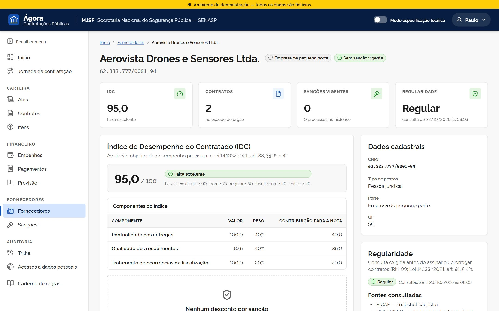

### Instaurar um processo sancionatório

Perfis: gestor de contratos e administrador.

1. Em **Sanções**, clique em **Instaurar processo**.
2. Em **Buscar fornecedor**, escolha o fornecedor e o **Contrato relacionado**.
3. Selecione a **Infração (art. 155)** e a **Sanção cabível em análise (art. 156)**, a **Data da intimação** e o **Relato dos fatos**.
4. Confirme em **Instaurar processo**. A aplicação de qualquer sanção depende de decisão da autoridade competente, após regular processo administrativo com contraditório e ampla defesa.

### Registro da sanção aplicada no CEIS/CNEP em até 15 dias úteis (RN-24)

Perfis: gestor de contratos e administrador.

1. Concluído o processo e aplicada a penalidade, a Ágora abre pendência automática para cumprimento do art. 161 da Lei 14.133/2021.
2. Na seção **Registro no CEIS/CNEP (art. 161)** da tela **Sanções**, o sistema calcula a data limite de 15 dias úteis com base no calendário de feriados do órgão e alerta quando o prazo está perto do vencimento.
3. Depois de registrar a sanção no sistema oficial da CGU, clique em **Registrar envio**, escolha o **Cadastro** (CEIS ou CNEP) e informe o **Protocolo do envio** e a **Data do envio**. A conformidade fica na trilha de auditoria.

### Simular a multa compensatória (art. 156)

1. No **Simulador de dosimetria da multa**, informe o **Valor do contrato**.
2. Escolha a **Gravidade da infração**.
3. Marque os **Agravantes** e **Atenuantes** que se aplicam. Indique também se há programa de integridade e se houve dano à Administração.
4. Clique em **Calcular proposta**.

O resultado mostra o percentual, o valor proposto da multa, a conferência com os limites legais (de 0,5% a 30%) e a **memória de cálculo**. O simulador não grava nada: é uma proposta para apoiar a decisão da autoridade competente.

### Simular a multa moratória (art. 162)

A multa de mora é a do atraso injustificado na execução, com o percentual diário e o limite de dias da cláusula do contrato.

1. No **Simulador de multa moratória**, informe o **Valor da parcela em atraso** e os **Dias de atraso**.
2. Confira **Percentual ao dia (%)** e **Limite de dias**. Eles começam com 0,5% e 30 dias e devem seguir a cláusula do contrato.
3. Clique em **Calcular multa moratória**.

O resultado mostra:

- os dias considerados e o percentual aplicado;
- o valor proposto da multa e a memória de cálculo;
- uma etiqueta, quando o atraso passa do teto de dias do contrato.

A multa de mora não impede a conversão em compensatória nem a extinção do contrato com outras sanções. A aplicação continua sendo decisão da autoridade competente, depois do prazo de defesa.

### Extensão dos efeitos da sanção (desconsideração da personalidade jurídica — art. 160, RN-27)

Perfis: o gestor de contratos propõe e registra a defesa; a assessoria jurídica emite o parecer; a decisão é do gestor designado como autoridade competente e do administrador.

Quando houver indício de utilização fraudulenta da personalidade jurídica para burlar sanções ou praticar atos ilícitos:
1. Em **Fornecedores › Vínculos e impedimentos**, a partir de um sinal de possível sucessão (na seção **Possíveis sucessões de empresas sancionadas** ou na página do fornecedor), o gestor clica em **Propor extensão da sanção**.
2. Descreva os fatos motivadores e indique os administradores com poder de gestão, sócios ou empresa sucessora que se pretende alcançar.
3. O sistema abre o contraditório com prazo de defesa de 15 dias úteis. O gestor usa **Registrar defesa** (ou informa que o prazo encerrou sem defesa).
4. A assessoria jurídica emite o parecer prévio obrigatório sobre a legalidade da desconsideração, com **Favorável à extensão** ou **Desfavorável à extensão**. Quem propôs não emite o parecer.
5. A decisão motivada cabe privativamente à autoridade competente, que usa **Registrar decisão**. O procedimento também pode ser arquivado. Sendo acolhida a extensão, o sancionado passa a constar com registro impeditivo no sistema pela vigência remanescente da sanção originária.

## 13. Central de notificações

Perfis: todos os que têm a tela no menu (consulta e preferências pessoais). Gestor de contratos, fiscal de contrato e administrador também enviam avisos.

A tela **Notificações (RF-26)**, no menu **Carteira**, centraliza a comunicação ativa do órgão com fiscais, gestores e empresas contratadas:

- **Varredura diária de vigências e vencimentos (RN-31):** o servidor verifica diariamente os prazos e emite alertas automáticos nas faixas de 120, 90, 60 e 30 dias para encerramento de contratos e atas de registro de preços.
- **Alertas operacionais:** notificações sobre prazos de defesa em processos sancionatórios, renovação de garantias, medições pendentes do IMR e reajustes devidos.
- **Canais de entrega oficiais:** as mensagens são transmitidas por e-mail institucional (servidor SMTP próprio do órgão), registro oficial no processo do SEI ou via Login Único gov.br, com fila assíncrona durável e controle de novas tentativas.
- **Preferências de notificação:** em **Minhas preferências**, cada usuário pode escolher os canais e tipos de aviso que deseja receber. Os avisos obrigatórios determinados por lei (como a notificação de encerramento em 30 dias) possuem bloqueio contra desativação.

## 14. Linhas de defesa e controle externo

Perfis: cada perfil vê a aba da sua linha. A 1ª linha atende gestor de contratos, fiscal de contrato, financeiro, planejamento e agente de contratação. A 2ª linha atende controle interno e assessoria jurídica. A 3ª linha atende o auditor. O auditor e o administrador veem as três.

No menu **Controle**, a tela **Linhas de defesa** organiza a atuação integrada das três linhas de defesa estabelecidas no art. 169 da Lei 14.133/2021. Os prazos das medidas de controle externo ficam na tela **Controle externo**, do mesmo menu.

### Painel das três linhas de defesa (RF-23)

1. **1ª linha — gestão e fiscalização:** visão operacional de **Pendências vencidas**, **Tarefas em atraso**, **Atestos atrasados**, **Processos com bloqueio**, **Revisões de riscos pendentes** e **Cautelares suspensivas**.
2. **2ª linha — jurídico e controle interno:** traz **Pareceres pendentes**, **Exceções justificadas**, **Sanções em andamento** e:
   - **Matriz de achados preventivos:** monitora aditivos próximos do limite de 25% e 50% do art. 125, contratos sem fiscal ou sem gestor designado, divulgação no PNCP vencida, sanção sem registro no CEIS/CNEP e pagamentos fora da ordem cronológica.
   - **Auditor contínuo (RIA-15):** algoritmo determinístico que varre pagamentos e medições, identificando notas fiscais com valor divergente da estimativa, faturas duplicadas e antecipações indevidas.
3. **3ª linha — auditoria (CGU e TCU):** acompanhamento de **Medidas com resposta pendente** e **Respostas com prazo vencido**, integridade da cadeia de auditoria e registros de revelação de dados pessoais. O botão **Baixar relatório executivo (PDF)** gera o relatório do período escolhido em **De** e **Até**.

### Controle externo e medidas cautelares (RF-24, RN-30)

Perfis: o controle interno e o administrador registram. Gestor, fiscal, planejamento, agente de contratação, assessoria jurídica e auditor consultam.

1. **Registro de medidas:** em **Controle externo**, o controle interno clica em **Registrar medida** e escolhe o **Órgão de controle** e o **Tipo de medida**. Informa o **Número da decisão ou do ofício**, a **Data da decisão**, a **Data da ciência pelo órgão**, o **Prazo fixado na comunicação (dias úteis)**, se é **Com efeito suspensivo** e o **Processo da jornada** ou o **Contrato** atingido. Depois, **Prorrogação**, **Resposta** e **Revogação** ficam na página da medida.
2. **Prazo de resposta (10 dias úteis):** a Ágora calcula o vencimento do prazo para cumprimento ou prestação de informações, exibindo semáforo de criticidade.
3. **Trava de cautelar suspensiva (RN-30):** havendo decisão cautelar com efeito suspensivo ativa, o sistema bloqueia automaticamente as ações de **Avançar etapa** e **Contratar** no processo correspondente até o registro formal de revogação da medida pela corte de contas.

### Base normativa soberana e precisão normativa IMR-02 (RNF-08, RIA-14)

No menu **Lei e qualidade normativa**, a tela **Base normativa** disponibiliza o texto da Lei 14.133/2021 guardado na Ágora, com busca por **Buscar na Lei 14.133/2021**. A tela **Qualidade normativa** afere a precisão normativa (IMR-02) das minutas produzidas pela aplicação, conferindo as referências legais citadas frente ao texto da lei. Nela, **Conferir as citações de um texto** confere um trecho colado, sem gravá-lo.

## 15. Gestão compartilhada com a sociedade e dados abertos

Perfis: o cidadão (autenticado pelo gov.br) envia e acompanha em **Minhas manifestações**. O gestor de contratos modera, responde e publica o relatório final. O fiscal de contrato publica registros da execução e responde. A tela **Gestão compartilhada**, no menu **Sociedade**, é dos perfis internos.

### Gestão compartilhada com a sociedade (RF-37)

Em atendimento ao art. 174, § 3º, VI, da Lei 14.133/2021, o portal oferece canal público para acompanhamento e manifestação da sociedade sobre contratos em execução:

1. **Envio de manifestações pelo cidadão:** o cidadão se identifica pelo Login Único gov.br e, na página pública do contrato, em **Enviar manifestação**, preenche **Assunto**, **Mensagem** e, se quiser, uma **Imagem**.
2. **Proteção e moderação prévia:** fotos têm metadados de localização (EXIF) descartados no recebimento para proteger a privacidade. Em **Gestão compartilhada**, o gestor vê as manifestações **Aguardando moderação** e usa **Publicar** ou **Não publicar**, com o motivo da decisão. O cidadão é identificado publicamente apenas pelo primeiro nome e iniciais.
3. **Respostas e prazos:** a Administração e a empresa contratada dispõem de 30 dias (prorrogáveis por igual período) para apresentar esclarecimentos públicos. O gestor ou o fiscal usa **Responder manifestação** na manifestação publicada.
4. **Acompanhamento e relatório final:** na seção **Acompanhamento da execução** do contrato, o fiscal usa **Publicar foto ou vídeo da execução**. Ao término da vigência, o gestor publica o **Relatório final** sobre a consecução dos objetivos da contratação.

### Catálogo de dados abertos (RF-38)

A página pública **Dados abertos** disponibiliza, sem necessidade de cadastro ou login:

- Conjuntos de dados de editais, contratos, atas de registro de preços, termos aditivos, pagamentos na ordem cronológica e processos sancionatórios;
- Formatos abertos CSV e JSON estruturados, acompanhados de dicionário de dados e licença aberta;
- Anonimização estrita em conformidade com a LGPD: exclusão de CPF e dados de contato de pessoas físicas, com nomes de empresários individuais mascarados.

## 16. Dados pessoais (LGPD)

CPF, e-mail e telefone aparecem **mascarados** em todas as telas. Só o auditor e o administrador podem ver o dado completo, e cada acesso fica registrado.

1. Ao lado do dado mascarado, clique em **Revelar**.
2. Em **Finalidade do acesso**, explique para que você precisa do dado (até 300 caracteres), por exemplo: "conferência de documento para emissão de nota de empenho". O campo é obrigatório.
3. Clique em **Revelar e registrar acesso**.

O acesso, com seu nome, data, hora e finalidade, aparece em **Auditoria › Acessos a dados pessoais** (LGPD, art. 37).

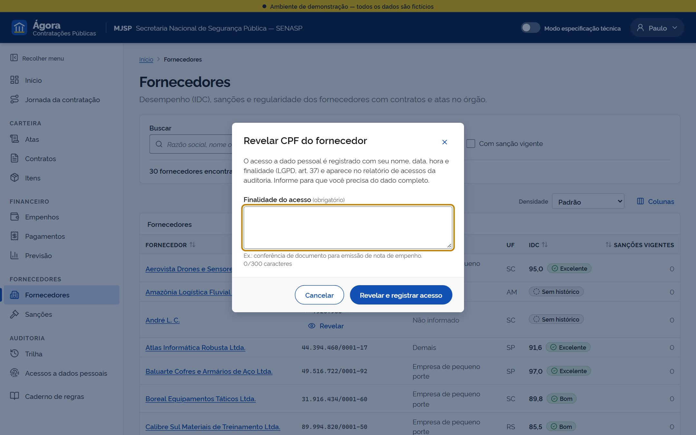

## 17. Auditoria e carimbo do tempo

Perfis: auditor, controle interno e administrador consultam a trilha. O administrador também ancora o carimbo de tempo.

A **Trilha de auditoria (RNF-03)** registra todas as escritas, acessos e sincronizações com encadeamento criptográfico por hash SHA-256.

1. Em **Auditoria › Trilha**, filtre os eventos por **Buscar no resumo**, **Ação**, **Recurso**, **De** e **Até**.
2. **Verificar integridade da cadeia:** clique em **Verificar integridade da cadeia**. O servidor recalcula a cadeia completa e atesta se houve qualquer alteração não autorizada no histórico.
3. **Carimbo de tempo (RNF-09):** na seção **Carimbo de tempo da trilha**, a Ágora ancora a trilha de auditoria em Autoridade de Carimbo do Tempo (ACT) no padrão RFC 3161. O administrador usa **Ancorar agora**, e **Verificar ancoragens** confere se os carimbos continuam íntegros.

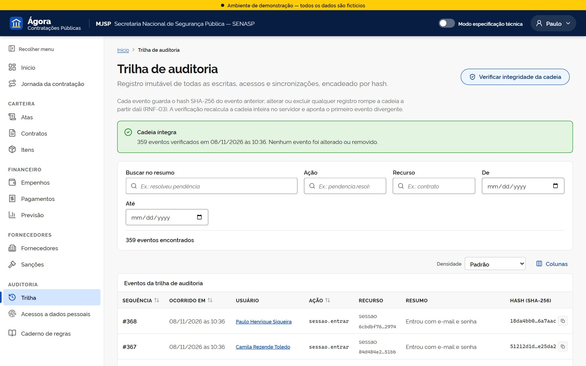

A tela **Acessos a dados pessoais** (menu **Auditoria**, perfis auditor e administrador) lista quem revelou qual dado, quando e com que finalidade.

## 18. Administração e operação sustentável

Perfil: administrador. As integrações também podem ser executadas pelo financeiro. Metas do ETP e Operação têm outros perfis de consulta, indicados nas seções.

### Usuários

1. Em **Usuários**, clique em **Novo usuário**.
2. Preencha **Nome completo**, **E-mail institucional** e **CPF**. O CPF fica mascarado nas listagens.
3. Marque os **Perfis**.
4. Informe as **UASGs do escopo**: códigos de 6 dígitos, separados por vírgula. Deixe em branco para administrador e auditor, que veem todas as UASGs.
5. Se for o caso, escolha a **Unidade interna** e salve.

Na lista de usuários, cada linha tem os botões **Editar**, **Desativar** e **Gerar senha temporária**. Ao gerar uma senha temporária:

- todas as sessões abertas da pessoa são encerradas;
- a senha aparece **uma única vez**, nessa tela, e expira em 72 horas;
- no primeiro acesso, a pessoa é obrigada a trocá-la.

### Perfis

**Perfis** mostra a tabela completa de permissões por perfil, só para consulta. Para mudar o que uma pessoa pode fazer, altere os perfis dela em **Usuários**.

### Fila de integrações assíncrona (RNF-07)

As sincronizações e publicações com sistemas externos (PNCP, Compras.gov.br, Contratos.gov.br e SIAFI) operam por fila durável em RabbitMQ no servidor:

- **Tarefas ativas e novas tentativas:** a seção **Fila de integrações** exibe a situação das tarefas e o número de tentativas, com espera crescente para falhas transitórias. Use o filtro **Mostrar** (**Fila de erro**, **Na fila** ou **Todas**).
- **Fila de erro:** ocorrências com erros definitivos ou limite de tentativas esgotado ficam retidas. Use **Reprocessar** para tentar de novo.
- Para rodar uma sincronização pontual, clique em **Executar agora**, em **Executar sincronização**.

### Painel das metas do ETP (RF-39)

No menu **Resultados e operação**, a tela **Metas do ETP** mostra os três demonstrativos de resultados pretendidos exigidos pelo art. 18, § 1º, IX, confrontados com as metas configuradas pelo órgão. Planejamento, gestor de contratos, controle interno, auditor e administrador consultam:

- **Tempo de instrução da fase preparatória:** duração média de cada etapa, medida pelos registros da trilha de auditoria;
- **Erros formais barrados pelas travas:** bloqueios feitos preventivamente pela aplicação (itens de luxo, ausência de parecer, certidões vencidas);
- **Economia: estimado × contratado:** diferença entre o valor estimado e o contratado, com o efeito dos expurgos da cesta de preços à parte.

O administrador define as metas em **Configurar metas**.

### Operação sustentável e disponibilidade IMR-01 (RNF-10)

A tela **Operação** (menu **Resultados e operação**, perfis auditor e administrador) exibe a **Situação agora** da plataforma e o relatório de disponibilidade do mês:

- **Medição de disponibilidade (IMR-01):** minutos considerados, minutos indisponíveis e minutos sem sondagem, com desconto das janelas de manutenção do PNCP. O administrador usa **Registrar janela de manutenção do PNCP**;
- **Consumo de energia (TI verde):** indicadores de consumo. O autoescalonamento e o desligamento dos ambientes fora do expediente são configurados na implantação, não nesta tela.

### Ajustes

- **Modelos de gestão:** definem as tarefas criadas automaticamente nos planos de gestão de atas e contratos, como a fiscalização mensal e o reajuste anual.
- **Unidades internas:** as unidades do órgão às quais os usuários pertencem.
- **Grupos de UASG:** grupos usados em compras compartilhadas. Grupos novos aguardam confirmação.
- **Feriados:** o calendário usado na contagem de prazos em dias úteis (art. 183). Os feriados nacionais são calculados automaticamente. Os locais são cadastrados em **Cadastrar feriado local**.
- **Políticas do órgão:** regras próprias do órgão. Hoje, **Exigir critérios de sustentabilidade e logística reversa no ETP e no TR**, com a **Justificativa da alteração**, que fica na trilha de auditoria.

## 19. Recursos para todos os perfis

### Modo especificação técnica

O botão **Modo especificação técnica**, no cabeçalho, mostra em cada tela as regras que ela aplica (requisitos funcionais, regras de negócio e sinais de IA), com o fundamento legal. Ele serve para auditores, para a área jurídica e para quem quer entender por que a Ágora age de determinada forma.

### Caderno de regras

**Caderno de regras** reúne todas as regras da Ágora, organizadas por etapa da jornada, com busca (**Buscar regra**) e filtro por **Tipo**. Use **Imprimir caderno** para gerar uma versão em papel ou PDF.

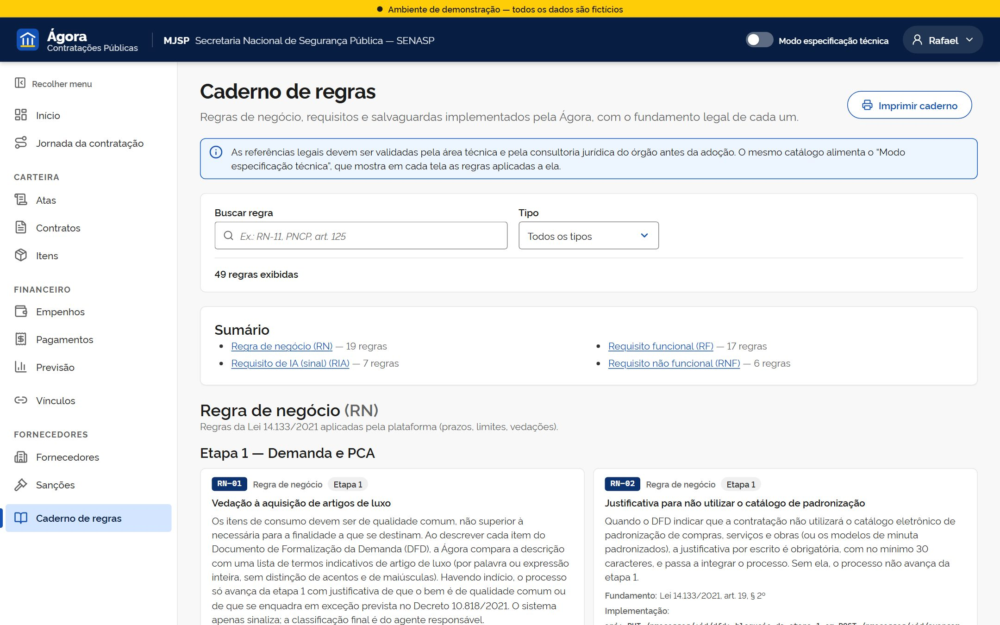

### Transparência

A página **Transparência: contratos** é pública: qualquer cidadão consulta os contratos sem entrar no sistema. Ela não mostra CPF nem e-mail, e fornecedores pessoa física aparecem com o documento mascarado.

### Editais publicados

**Transparência: editais publicados** lista os editais publicados na etapa 5 da jornada. Cada edital tem uma página com os dados da publicação e o **inteiro teor** em PDF: edital, termo de referência e minuta do contrato.

- Os documentos são a última versão aprovada e saem com CPF, e-mail e telefone tarjados.
- O acesso é livre, sem cadastro nem login (art. 25, § 3º).

Quando a publicação for feita no PNCP pela integração do órgão, a página também mostra o link para o registro oficial no portal.

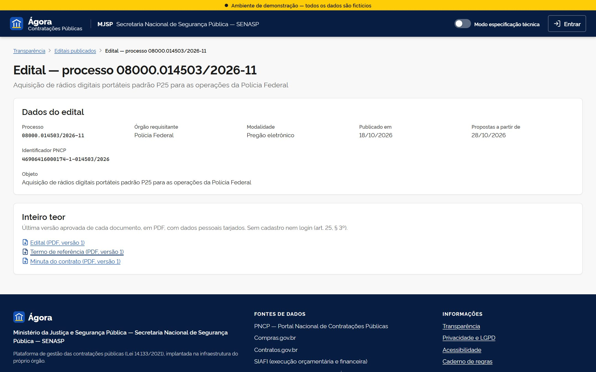

## 20. Dúvidas frequentes

**Não encontro uma opção no menu.**
O menu mostra só o que o seu perfil permite. Peça ao administrador para revisar seus perfis e seu escopo de UASGs.

**Esqueci a senha ou a entrada foi bloqueada.**
Depois de 5 tentativas erradas, espere 15 minutos. Se esqueceu a senha, o administrador gera uma senha temporária, que vale por 72 horas e precisa ser trocada no primeiro acesso.

**O processo não avança de etapa.**
Leia o aviso: ele lista cada regra não atendida, com a explicação e o artigo da lei. Resolva no painel da etapa e tente de novo. Sinais não impedem o avanço; bloqueios impedem.

**A IA toma decisões?**
Não. A IA, quando o órgão a habilita, só redige rascunhos e aponta sinais, sempre com fontes e com revisão humana obrigatória. Habilitação, sanção, multa, conclusão do parecer e qualquer impedimento são sempre decisão de uma pessoa. Por padrão, a Ágora funciona sem IA nenhuma.

**Dá para desfazer uma ação?**
Resolver pendência e vincular instrumentos têm **Desfazer** no aviso. O atesto de nota fiscal não pode ser desfeito pela tela. Toda ação, desfeita ou não, fica na trilha de auditoria.

**Apareceu um erro com "Código para o suporte".**
Copie o código e envie ao suporte do seu órgão. Ele permite localizar exatamente o que aconteceu, sem expor seus dados.
